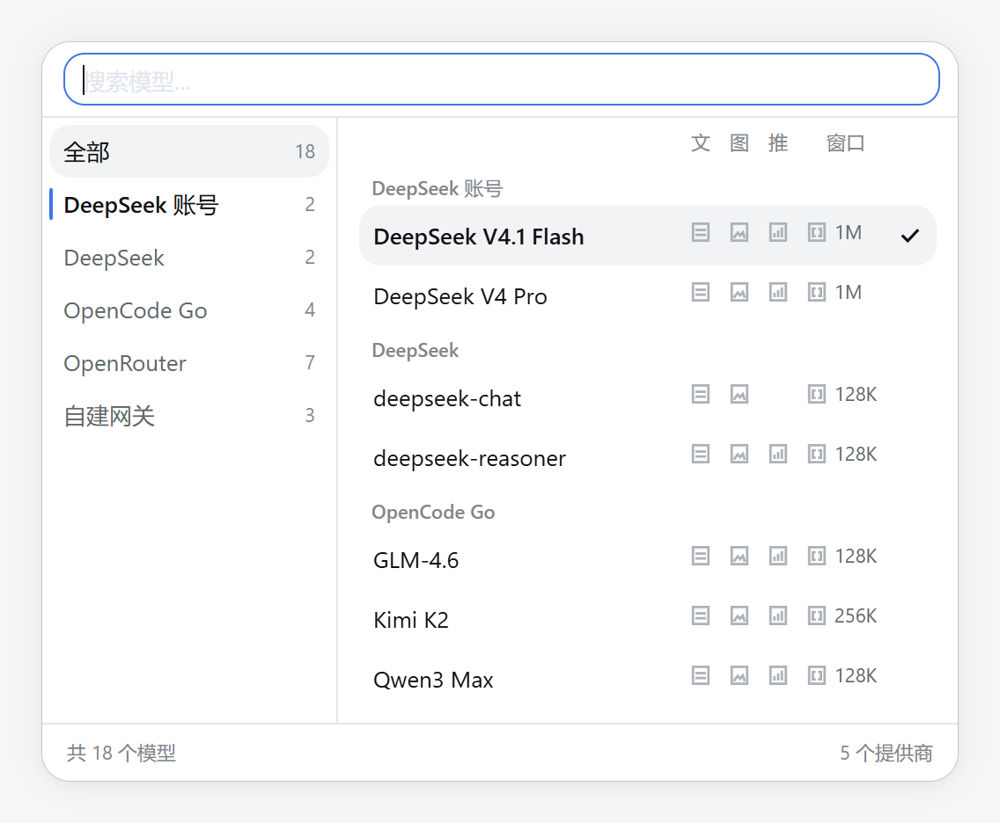
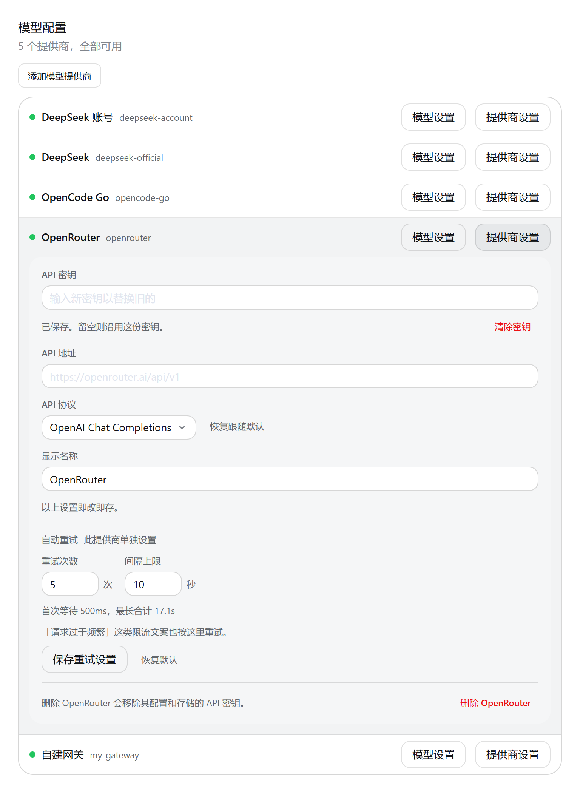

# dsh-rabbit-model-picker

DSH（DeepSeek Harness）输入条里的模型选择器，换成一张**两窗格模型卡**：左边提供商栏，右边模型列表。
同一个插件还带一个与官方「模型」页并存的**设置 → 模型配置**页，以及在 Host 侧把被误判的
**限流文案**重新交给内建重试执行器。

装、卸都只改 profile（依赖 + 一条 Loader 行），不改 DSH 安装目录。



*静态预览；上图把范围切到了「全部」，打开时默认收窄到当前会话的提供商。*

## 模型卡

- **只替换座位**：`conversation.input.model` 这一格换成模型卡与齿轮。宿主自带的 `/model` 弹窗
  和官方「模型」页都不替换；`/model` 与本插件读同一份 per-session 目录状态，任一处切换会同步。
- **触发器说出身份**：`提供商/模型名 · 推理等级`。两个提供商可以有同名模型，
  所以提供商前缀不是装饰；输入条窄到放不下时按宿主变量折成图标。
- **打开时从当前会话的提供商开始**：提供商栏高亮当前会话，模型列表只列它；点第一行「全部」
  才展开所有提供商。范围是纯前端状态，不写 Host，下一次打开重新开始。
- **搜索常驻、匹配全部提供商**：范围只影响列表，不影响搜索。在收窄状态下搜到别处的模型时，
  列表会写出「其他提供商还有 N 个匹配」并给一个「显示全部」。
- **四列事实固定**：文字 / 图片 / 推理 / 窗口。模型缺哪项，就留空哪一列，不移动邻居；
  搜索行下面那行表头把四列说一次。事实读取顺序是「设置里的声明 → 适配器发布的目录 →
  provider 级默认」，三者都没有的不画。
- **点行 = 选模型**，当前行带勾；再点当前行等于关闭。行内没有可编辑控件，推理等级在齿轮里改。
- **键盘**：`↑↓` 移高亮、`Home` / `End` 跳首尾、`Enter` 选中、`←` 进提供商栏、`Tab` 按渲染顺序
  走完整张卡；`Esc` 先清搜索，再关卡片。
- **窄屏 ≤536px**：提供商栏折成横向条放在列表上方，还是同一份 DOM、同一套 ARIA。

## 参数面板


点齿轮打开。页首是模型名与提供商，下面三段：

| 段 | 能改什么 | 写到哪里 |
|---|---|---|
| 输入类型 | 文字 / 图片开关 | 适配器对该模型的声明（`settings/mutate`，即改即存） |
| 上下文窗口 | `128K` / `256K` / `512K` / `1M` / 自定义 | 同上；清空输入框 = 撤掉声明，回到默认 |
| 推理等级 | 适配器声明的档位 | 会话选择（`directory.select`），**只影响本会话** |

每段第一行是「标签 + 来源」：已自定义 / 内置目录 / 适配器默认 / 未声明，
推理等级固定「仅本会话」。值由下面的控件陈述；只有控件显示不了时（例如继承态、额外模态）
才由读数补出生效值。路由不可寻址或部署只读时，控件禁用并写明原因；事实来自只读目录时同样
只陈述，不假装可写。页脚只留范围句「仅对当前模型生效」与「恢复默认」（已声明时）。

## 设置 → 模型配置



*上图是 OpenRouter 这一行的设置井展开时；其余行保持账本行。*

- **与官方「模型」页并存**，不遮蔽；官方页始终安装着，是随时可用的退路。
- **只列已添加的提供商**：每行是一个提供商，状态点绿 / 红；右端并排「模型设置」「提供商设置」。
  未添加的提供商收在「添加模型提供商」里。
- **设置井**（点「提供商设置」在行内展开）：API 密钥（只写、不回显，可清除）、API 地址、
  API 协议（schema 声明时）、显示名称（schema 声明时）、重试编辑器（schema 声明 `retryPolicy` 时），
  末行是「移除提供商」，删除前有行内两步确认。常规字段即改即存，没有提交按钮；重试编辑器
  有自己的保存 / 恢复默认。
- **模型目录区**（点「模型设置」在行内展开）：逐模型花名册 + 每行的编辑井（模型 ID、显示名称、
  上下文窗口、最大输出、输入类型、推理档位），支持添加 / 删除模型、恢复默认模型，以及
  **模型发现**（发现 → 勾选 → 落盘）。它是行内展开区，不是第二个弹层，设置弹窗仍是唯一 modal。
- **添加模型提供商**：从目录添加一个休眠提供商，或手写自定义模型 API。目录添加卡只收可空的
  密钥与 API 地址，其余字段在添加后的设置井里配。
- 设置与凭据的写入走 Host 服务：设置走 `settings/mutate`（带 revision，冲突重读一次），凭据走
  `credentials/set` / `credentials/unset`。文案中英双语。

## Host：限流文案恢复

有的网关在流里回「请求过于频繁」这类话，却不带 HTTP 状态码。宿主分类器只认 `429`、`rate limit`
与英文 quota 措辞，于是这类失败会落进不可重试的兜底码，重试策略一次都不会被咨询。

本插件在 `agent/request-error` 瀑布的最外层做一条判定：如果失败的 code 不在策略的可重试列表里、
策略仍保留 `RATE_LIMIT`、没有状态码或状态码是 429 / 408 / 5xx、且文案命中限流措辞，就把这条
失败按 `RATE_LIMIT` 重新提交给内建重试执行器。它**不自己等待、不自己计数、不写会话事件**——等待
节奏与次数仍由重试编辑器里那两个数字决定。去掉策略里的 `RATE_LIMIT` 即整体关闭。

## 安装

由 DSH 的插件管理器写 profile，不要手改 profile 的 `package.json` / `cordis.patch.yml`。
在「插件」里打开添加插件，粘贴：

```text
github:a285292107s/dsh-rabbit-model-picker
```

本机开发也可以把仓库目录直接交给插件管理器：

```text
plugin_manager { action: "install_bundle", target: "C:/path/to/dsh-rabbit-model-picker" }
```

安装后包内的 `cordis.patch.yml` 会插入一条 Loader 行。回退时移除插件，或删掉那一行 insert，
刷新页面后座位回到 DSH 的默认选择器。

> **git 安装不会构建。** `lib/index.js` 与 `lib/client.js` 是**提交进仓库**的构建产物；
> 改了 `src/` 必须 `npm run build`，并把重建后的 `lib/` 与 `src/` 一起提交。否则用户装到的
> 是旧行为，或者 `failed to import`。

## 开发

单包 npm 项目，Node 22+。

```bash
npm install
npm run build     # esbuild -> lib/index.js（Host）+ lib/client.js（Browser）
npm run typecheck # tsc --noEmit，只查 src/
```

- `src/` 是唯一真源，`lib/` 是提交进仓库的产物；两者必须同一提交。
- 改 Browser 半区：重建后刷新页面生效。宿主按产物哈希取 client 模块，浏览器可能缓存旧包——
  先禁用缓存再 reload，并在记录结论前确认 bundle 里确实有新改动。
- 改 Host 半区：需要重启 `dsh web` 才会加载新的 `lib/index.js`；重启只由你来做。
- **仓库没有自动化测试**（单元、集成、改坏验证都没有）。CI 只跑 `typecheck` 与 `build`；
  `build` 自带的接线自检是唯一的机器门。视觉与行为验证在真实 GUI 里做；README 的图是静态预览，
  不能替代真机验收。

## 已知边界

- 插件依赖 DSH 的客户端契约：`conversation.input.model` 座位、`settings.section`、模型目录 /
  设置 / 凭据 Remote、`MenuSurface` 等。按 DSH `0.2.1-rc.2` 开发；DSH 升级后先核对
  [CONTEXT.md](CONTEXT.md) 里的契约，再重新构建。
- 本页只列已添加的提供商，未添加的收进添加入口；这是与官方页同向的选择，不是能力缺失。
- 不复刻官方页的开通卡、登录引导与欢迎公告；官方页始终在，能力不会丢。
- 目录添加卡只收密钥与地址；逐模型编辑留在创建后的模型目录区。
- 重试编辑器只在 schema 声明了 `retryPolicy` 的提供商里出现；schema 读不出来时整个入口不渲染。
- 限流文案恢复只处理文案被判错、而策略里仍有 `RATE_LIMIT` 的失败；它不改变原始失败记录，
  也不替代重试策略。
- 本文的效果图是**静态预览**：真实样式表 + 宿主真实 `--dsw-*` 令牌 + 中性演示数据，不是真机截图。
  它能证明排版与几何；滚动、焦点链与 Esc 分层请在真实 GUI 里确认。主题跟随宿主，暗色由同一份
  `--zmd-*` 令牌映射，不需要另做一套图。

## 文档

- [CONTEXT.md](CONTEXT.md)——术语、行为边界与废弃叫法
- [docs/models-page-parity-checklist.md](docs/models-page-parity-checklist.md)——「模型配置」页与官方页的对等清单
- [docs/official-models-page-notes.md](docs/official-models-page-notes.md)——官方模型页的取材记录
- [docs/settings-models-tab-feasibility.md](docs/settings-models-tab-feasibility.md)——平行 tab 的可行性研究（史料）
- [docs/adr/](docs/adr/)——方向级决策
- [docs/agent-safety.md](docs/agent-safety.md)——在本机跑 DSH 时的运行纪律
- [LICENSE](LICENSE)——MIT
