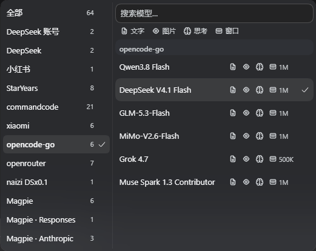
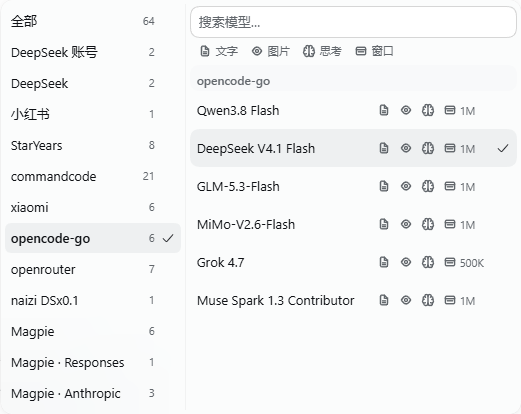
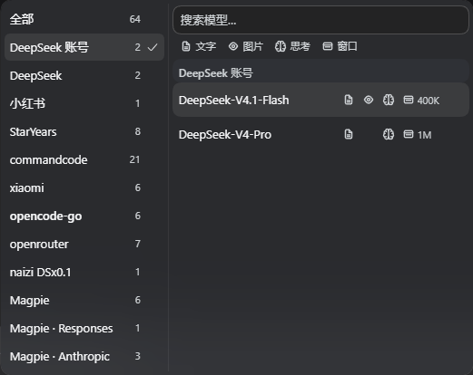
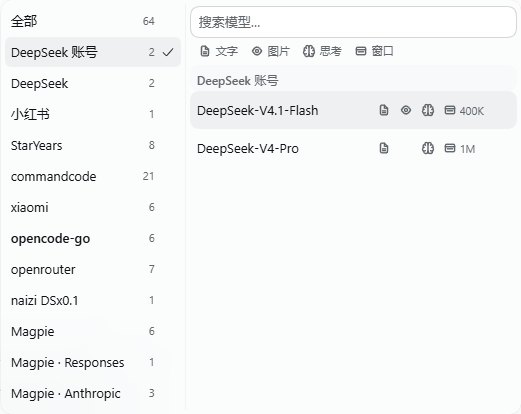
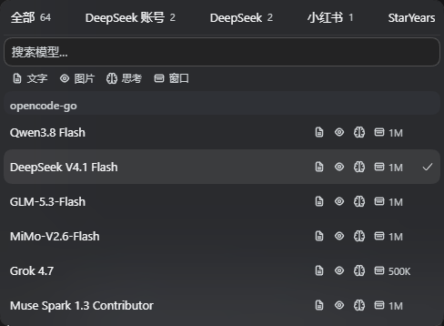
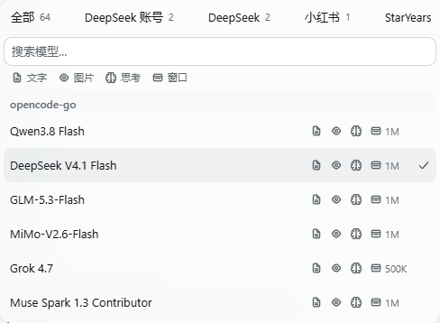
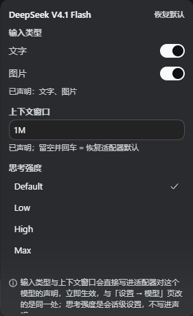
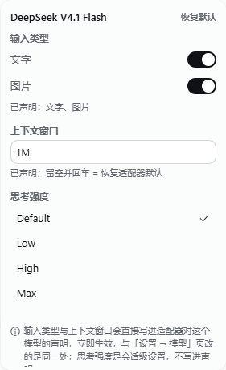

# dsh-rabbit-model-picker

DSH 输入框模型选择器的外部替换件。把「Model / Effort 两格 → 各自二级面板」换成**一张卡、两个窗格**——
左边是提供商栏，右边是模型列表：

- **触发器说出模型的身份**：`模型提供商/模型名 · 思考强度`（例如 `opencode-go/DeepSeek V4.1 Flash · Default`）。
  提供商前缀不是装饰：两个 provider 真的有同名模型，座位必须说清这个会话在哪一个上。
- **左侧提供商栏**：`全部` + 每个真实 provider（带模型数）。**每次打开面板都从当前会话正在用的
  提供商开始**（不是上次选过的那个，也不持久化），点一行就把右栏收窄到它，卡片**不关**、焦点直接
  落到搜索框；要看全部就点第一行 `全部`。
- **右侧模型列表**：搜索常驻、按 provider 分组、每行用只读徽章陈述事实
  （文字 / 图片 / 思考强度 / 上下文窗口）。
- `/model` 与 Host 侧逻辑不动。

设计依据与逐条契约见 [DESIGN.md](DESIGN.md)（本次改版：§5.26 + §8.12；两栏本身见 §5.25 + §8.11）。

## 特性

- **不改 DSH 安装目录**：profile 依赖 + 一个 Loader 行即可。
- **完全可回退**：删掉那一行（或把 `priority` 改成 `> 0`）即恢复原控件。
- **不复制状态**：目录 / 选择 / pending / 错误全部读同一个 per-session store，任一处切换立刻同步。
- **范围只影响视图**：提供商范围是纯前端状态（连本地存储都不写），不写 Host，`/model` 与触发器不受影响。
- **每次打开都回答"我从哪儿切"**:面板一开就是当前会话的提供商和它的模型列表，高亮落在当前模型上；
  想横向比较再点 `全部`——**范围的生命周期就是这一次打开**，因此它永远不会和触发器说的身份打架。
- **搜索不被范围吃掉**：在一个 provider 里搜不到、但别的 provider 有时，卡片会写出
  「其他提供商还有 N 个匹配」并给一个「显示全部」——不会读成"没有这个模型"。
- **窄屏同一份 DOM**：视口窄到装不下两栏（≤536px）时，提供商栏折成**横向条**放在列表上方，
  范围照样看得见、点得到；roving focus / ARIA 结构不变。
- **行内无控件**：徽章只说事实，点行 = 选模型；**思考强度只在齿轮参数面板里改**。
- **四个事实是一张表**：四列固定、缺失的事实留空位，卡内表头把四列说一次（文字 / 图片 / 思考 / 窗口），
  所以列表能上下比较同一件事，模型名的省略号落点也逐行一致。详见 DESIGN.md §5.24。
- **内置目录也照样陈述**：模型来自适配器内置目录、配置里没有声明条目时，模态与窗口从**适配器自己
  发布的目录**读（`llm/discoverModels` / 适配器自有 Remote），而不是留白或猜。**适配器还没挂载**与
  **适配器什么都没发布**是两件事：前者留着下次重试，所以开卡早于适配器挂载也读得到事实（DESIGN §5.27）。
- **对比度达标**：面板文字全部过 WCAG AA，由 `npm run contrast` 逐样式量出（含提供商栏的每一行）。
- **动效有一条声线**：卡片入场（从锚点角 scale 落定）、悬停过渡、按压缩放、选中勾弹跳共用一条
  减速曲线，只动 transform 与背景色；`prefers-reduced-motion` 下全部关掉，键盘滚动只在
  no-preference 下平滑。透明度淡入被对比度门天然禁止——理由见 DESIGN.md §5.23。

## 效果

| | 深色 | 浅色 |
|---|---|---|
| 模型卡：打开即落在当前会话的提供商 |  |  |
| 模型卡：左栏切到别的提供商，右栏只列它 |  |  |
| 窄屏：提供商栏折成横向条 |  |  |
| 参数面板 |  |  |
| 参数面板：模型来自适配器内置目录（§5.19 实测） |  | — |

| 座位行（触发器 · 齿轮） |
|---|
|  |

## 交互

| 动作 | 结果 |
|---|---|
| 座位上的触发器 | 写 `提供商/模型名`，右侧跟当前思考强度；窄屏按 composer 的显示变量整段折成图标。悬停气泡给出完整身份；`aria-label` 同样带提供商与强度 |
| 点触发器 | 打开卡片：**左栏选中当前会话的提供商**，右栏只列它的模型、高亮落在当前模型上；左栏同时列出 `全部` 与其它 provider（带模型数，加载失败的排最后且不可选） |
| 点左栏某一行 | 右栏只列该 provider 的模型；这一行 `aria-selected` 并带选中勾；**卡片保持打开**，焦点落到搜索框 |
| 点左栏「全部」 | 显示全部 provider（这一次打开有效）。**如果你想找的模型在别的提供商，这是唯一出口** |
| 关闭再打开 | **回到当前会话的提供商**——不管上次停在哪个 provider，也不管上次是不是停在 `全部`（不写 localStorage） |
| 左栏的「当前会话」标记 | 这个会话真正在用的那个 provider：`aria-current` + 名字重一档（**不写字**——一行里再塞「当前会话」会把 provider 名挤成省略号，而那正是这一栏唯一的活） |
| 点模型行 | 切模型，卡片关闭；点已选中的行 = 关闭 |
| 搜索 | 常驻、跨 provider 模糊匹配；**范围不影响搜索**——在收窄状态下搜到别处的模型会显示「其他提供商还有 N 个匹配」+「显示全部」 |
| 悬停某行 | `title` 给出整句事实（模型名、输入类型、强度、上下文窗口） |
| 点齿轮 | 打开参数面板：输入类型、上下文窗口、思考强度；profile 已声明的项带小圆点标记 |
| 参数面板改输入类型 / 上下文窗口 | **真写进 Host**：改适配器对模型的声明，立即生效；底部写明写入位置 |
| 参数面板填上下文窗口 | 接受 `128K` / `1M` / `262144`；留空 = 撤掉声明回到适配器默认 |
| 参数面板点「恢复默认」 | 撤掉本 profile patch 里的声明；无声明时按钮禁用 |
| 参数面板点思考强度 | **唯一改强度的地方**：走 `directory.select()`，改完行内徽章同步 |
| 无法寻址的路由 | 面板写明原因，并**陈述适配器目录公布的事实**（可编辑的控件仍然全部禁用）；适配器什么都没公布时，对应分区整块不渲染，不画成"不支持" |
| 键盘（列表） | `↑↓` 移高亮、`Home`/`End` 跳首尾行、`Enter` 选中；`←` 进提供商栏；`Tab` 在 左栏 → 搜索 → 各行 之间走 |
| 键盘（左栏） | `↑↓` 在行间移焦点、`Home`/`End` 跳首尾、`Enter`/`空格` 采纳并回到搜索框、`→` 回搜索框；`Esc` 关卡片 |
| 问答/审批/只读子代理顶掉输入条时 | 两个弹窗一起关掉（不还焦点）。判据是座位根有没有盒子，窄布局不误关。详见 DESIGN.md §5.18 |

## 行内徽章

每行右侧四个只读徽章，顺序固定。前三个自绘于宿主 16 单位网格，思考强度用宿主 24×24 大脑，
两套网格线重均为 1.4px。

**四列固定**：每行始终画出四条轨道（`文字 / 图片 / 思考 / 窗口`），模型没有的事实**在它自己的列里留空**，
不画斜线、也不把邻居左移。所以四列逐行对齐、模型名那一列逐行等宽（实测 10 行全是 160px），
眼睛可以上下比较同一件事。搜索框下面那行**表头**把四列各是什么说一次（11px、次级墨色、不滚动）。

| 徽章 | 含义 | 值 |
|---|---|---|
| 文字输入 | 该模型接受文字 | 不支持时该列留空 |
| 图片输入 | 该模型接受图片 | 同上 |
| 思考强度 | 该模型能不能思考（不是当前档位） | 同上 |
| 上下文窗口 | 该模型声明/默认的窗口 | 整数 + K/M（`1M` / `128K`，不出现 `1048576` 或小数） |

读取顺序就是适配器自己的顺序——**声明 → 适配器发布的目录 → 适配器的 provider 级默认**
（pi-ai 的 `entry.contextWindow ?? base?.contextWindow ?? defaultContextWindow`，
opencode-go 的 `modelInfo()` 同序），所以徽章和适配器实际用的值一致。

- **紧凑**：四条轨道固定为 14 + 8 + 14 + 8 + 14 + 8 + 47 = **113px**（窗口列 = 14px 字形 + 3px 间距 +
  30px 值），320px 卡片里模型名恒有 160px。改造前常见三事实行约 107px、四事实行约 129px——
  **最坏情况反而变窄**，而且名字列的宽度不再逐行变化。详见 DESIGN §5.24（正文）与 §5.12（历史）。
- **不猜**：模态与窗口先读 Host 设置快照，设置里查不到的再读适配器发布的目录；两者都查不到的**不显示**，不会画成"不支持"。
- **只读**：适配器目录来的事实没有任何可写目标，参数面板里对应分区禁用并写明来源。
- **可读**：徽章条带 `title`，整句同时是行的 `aria-label`，屏幕阅读器听到的是整句而非裸数字。
- **不可交互**：用宿主 `Tag` 原语 + `aria-hidden`，点徽章 = 点该行，无隐藏行为。

## 安装

由 DSH 自己写 profile（不要手改 profile 的 `package.json` / `cordis.patch.yml`）。
在插件的「添加插件」输入框里粘贴包名即可：

```
dsh-rabbit-model-picker
```

也可以粘 GitHub 地址：

```
github:a285292107s/dsh-rabbit-model-picker
```

或写成 `https://github.com/a285292107s/dsh-rabbit-model-picker`。

这条命令：拉取/安装 → 加进 `dsh.profile.bundles` → 应用包内 `cordis.patch.yml` 的 insert 行。
返回 `application: applied` 即生效；页面刷新后新座位接管。

> ⚠ **git 安装不会构建。** `lib/` 是**提交进仓库**的产物，不是安装时生成的——pnpm 拉 git
> tarball 只搬运仓库里已有的文件，没有构建步骤。所以改了 `src/` 必须重新 `npm run build`
> 并连同 `lib/` 一起提交，否则用户装到的是旧行为（或 `lib/` 缺失时报
> `failed to import`）。`npm test` 里的 `test:fresh` 门会拦住这种漂移。
> （npm 发布走 `files` 白名单，同样只有在 `prepublishOnly` 构建后才会带上 `lib/`。）

**本机开发**用 `link:` 指向工作目录（改完 `npm run build` 刷新页面即生效）：

```
plugin_manager { action: "install_bundle", target: "C:/Users/28529/Desktop/dsh-rabbit-model-picker" }
```

**回退**：`plugin_manager { action: "remove_bundle", target: "dsh-rabbit-model-picker" }`，或删掉 insert 行。

## 开发

```bash
npm install          # esbuild + typescript + @types/react
npm run build        # esbuild → lib/index.js（宿主）+ lib/client.js（客户端）
npm run typecheck    # tsc --noEmit（含 noUnusedLocals/Parameters）
npm run test:fresh   # 已提交的 lib/ 是否是已提交的 src/ 的忠实产物（产物漂移门）
npm run selfcheck    # 静态禁令 + 座位契约 + 文案键 + 两栏/提供商栏/触发器契约
npm run contrast     # 文字对比度门：两个主题下按真实字号判 WCAG AA
npm run test:params  # 参数寻址/容量 + 行内事实推导 + 面板文案决策的单元门
npm test             # typecheck + build + test:fresh + selfcheck + contrast + test:params
```

> 这六道门在 GitHub Actions 上随每次 push 跑一遍（`.github/workflows/test.yml`）：
> `lib/` 漂移会在 push 阶段被拦下，而不是等某次 git 安装装到旧行为。

> `lib/` 是提交进仓库的（见「安装」）。**动过 `src/` 就要把重建后的 `lib/` 一起提交**，
> `npm run test:fresh` 会在两者不一致时失败。它比较的是 **HEAD 里的那一对**
> （`git archive HEAD src tsconfig.json` 重新构建，对上 `git show HEAD:lib/…`），
> 也就是 git 安装真正收到的东西——所以它不关心门跑在 `build` 之前还是之后，
> 也不会因为工作区改了一半就报警。

`npm run contrast` 优先读本机装的 DSH 主题表；没装时回落到仓库里提交的
`scripts/theme-tokens.json`（`npm run theme:fixture` 可重新生成），因此在 CI 上
也是真的在量，而不是打一行 `skip` 就绿。它量的是两种下层底色里较差的那种，
面板浮在哪一层都不影响结论。

浏览器端验收（页面需已用 `dsh web` 打印的 URL 完成认证）：

```bash
playwright-cli -s=verify open 'http://127.0.0.1:3080/?token=<token>'
playwright-cli -s=verify --raw run-code --filename=./scripts/_accept-provider-rail.cjs   # §5.25/§5.26 两栏 + 触发器身份 + 范围
playwright-cli -s=verify --raw run-code --filename=./scripts/_accept-anchor-loss.cjs     # §5.18 锚点消失
```

> ⚠ 改了 `src/` 后 **`location.reload()` 不够**：Loader 用 `rev` 键给 client 模块，浏览器可能返回旧 body。
> 先 `Network.setCacheDisabled` 再 reload，并在记录结论前断言 bundle 里确实有改动。
> `_accept-provider-rail.cjs` 的第 0 步就是这条断言（还顺带断言旧 popover 的符号已经不在了）。
>
> ⚠ 本目录自 2026-10-02 起有 git 历史（`master` → `origin`），但早期被误删的几个验收脚本
> （`_badges-probe.cjs` / `_icons-probe.cjs` / `_verify-fixes.cjs` / `_verify-settings.cjs`）不在任何提交里，
> DESIGN.md 里对它们的引用仍是待重写的清单。

改了 `lib/client.js` 后刷新页面即可：宿主按产物哈希拼接 client 模块，重建后刷新会取到新文件。
（`lib/` 已提交进仓库——见「安装」，重建后记得连同 `src/` 一起提交。）

## 结构

```
src/index.ts               宿主半边：空 apply
src/client/index.ts        入口：inject 声明 + slots.inject → register(priority:-10)
src/client/Picker.tsx      触发器（`提供商/模型名 · 强度`）+ 齿轮 + 两栏模型卡
src/client/ProviderRail.tsx 左栏：范围列表（全部 + 各 provider + 失败行），listbox + roving focus
src/client/BadgeIcons.tsx  四个徽章图标（只有"具备这个事实"一种形态；缺失的事实不画）
src/client/facts.ts        徽章词汇表（渲染层与推导层共用）
src/client/badges.ts       行内事实推导（纯函数）
src/client/capabilities.ts 适配器发布的能力目录（只读事实 + 读取策略）
src/client/adapterCatalog.ts 适配器自有目录的读取器与路由表（"没挂载"≠"什么都没发布"）
src/client/format.ts       徽章专用窗口写法（整数 + K/M）
src/client/effort.ts       强度档位命名与列表
src/client/SettingsMenu.tsx 模型参数面板
src/client/panelCopy.ts     面板文案（纯数据）
src/client/anchorLoss.ts    座位离开版面判据（纯逻辑）
src/client/params.ts        参数寻址与读写（含 revision 冲突重试）
src/client/retiredScope.ts  旧范围记录的键前缀 + 一次性清理（数据契约，不含行为）
src/client/dictionary.ts    zh/en 文案 + 本地兜底
src/client/styles.ts        注入样式表（全部走 --dsw-* 令牌）
src/client/contract.ts      外部结构类型 + `rowKey`（行身份 `${provider}/${model}`，
                            原住在已删除的 recent.ts，现在归这里）
src/client/primitives.d.ts  唯一运行时基线依赖类型边界
scripts/build-client.mjs    esbuild 构建 + 接线自检
scripts/selfcheck-static.mjs 静态禁令 + 契约 + 徽章紧凑预算等
scripts/check-contrast.mjs  文字对比度门
scripts/test-params.mjs     参数寻址/事实推导/文案决策 + 旧范围键清理的单元门
scripts/mutate-anchor-loss.mjs §5.18 改坏验证
scripts/_accept-provider-rail.cjs §5.25/§5.26 浏览器验收（两栏、触发器身份、范围每次重来、越界搜索、窄屏折叠、键盘）
scripts/_accept-anchor-loss.cjs §5.18 浏览器验收
scripts/_accept-capabilities.cjs §5.19 浏览器验收（只读：内置目录的模型到底读到了什么）
scripts/_verify-settings-layout.cjs 参数面板仍是"头在上、正文在下"的列（材质类共用的守卫，§5.25）
scripts/_audit-shots.cjs      品质自查截图（两张主题 × 四类表面；当前宿主跟随系统深色，浅色走「设置 → 外观」）
scripts/_taste-readme-shots.cjs 重拍 README 用的表面，含窄屏折叠那张（深/浅两套，见 DESIGN §5.24/§5.25）
scripts/_dump-tokens.cjs      按主题打印宿主令牌原值（设计改动前查 --dsw-* 用，只读）
scripts/_anchor-loss-probe.cjs  复现锚点消失（开发用，只读）
scripts/_squeeze-probe.cjs     窄输入条压测（开发用，只读）
```

## 依赖的外部契约（升级 DSH 后先跑自检）

| 契约 | 为什么关键 |
|---|---|
| `conversation.input.model` 是 `single`、最低 `priority` 渲染 | 靠 `priority: -10` 遮蔽默认 0；同优先级重复注册会抛错 |
| `ctx.slots.inject(name, cb)` | 插槽由 ui-conversation 声明，注册时机与声明顺序无关 |
| 座位面 `{ available, directory, load, select }` | 直接读注入面，无中间层 |
| `remote` + `remote.session` 必须自己 inject | `directoryFor()` 读 `this.ctx.remote.session`；不声明则座位让位（静默回退） |
| `remote.settings` / `remote.llm` 用 `ctx.get` 取，不进 inject | 精简/旧部署可能没有；写进必需注入会让整个座位让位。取不到时面板降级为只读 |
| 这两个面**每次读时**才 `ctx.get`（`settingsFaceOf` 返回取值函数） | remote 命名空间是异步挂载的：激活时抓到 `null` 会变成"这个部署没有设置服务"这个**假的事实**，且整页只读。真不挂的部署仍然照实报只读 |
| `llm/listConfigurableProviders` → `{ provider, settingsNs, settingsPath }` | 路由 → 配置位置的唯一权威映射 |
| `settings/describe` → `{ value, user, revision }` | `value` 是真值，`user`（profile patch）判断是否自己声明过 |
| `settings/mutate` 只接受 volatile 路径，冲突码 `settings/conflict` | 写入唯一入口；冲突要重读重试，拒绝显示原话 |
| 适配器把模型参数声明为 volatile | 非 volatile 路径会被拒绝；本插件只改这两类字段 |
| `llm/discoverModels(settingsNs, { provider })` 是 `@Remote`，返回 `contextWindow / maxTokens / inputModalities` | 内置目录路由的只读事实来源；`declared !== true` 才调用——适配器自称"只从配置知道"时这次调用会去打 endpoint |
| 适配器自有的 remote 命名空间（如 `opencodeGoModels/read`） | 有的适配器（`dsh-opencode-go`）不注册 configurable provider，这条是唯一读得到它的路 |
| remote 命名空间一律是 `remote.<namespace>` 服务，且**异步挂载** | 读取时按需 `ctx.get`，才不会把插件激活顺序变成事实来源；**命名空间还没挂载时"读不到"**（不是"适配器什么都没发布"），这样开卡早于挂载也不会把唯一一次询问消耗掉 |
| 宿主 `--dsh-composer-model-text-display` / `--…-icon-display` | 窄屏折成图标；不消费就挤爆工具行 |
| 宿主 label 令牌对比度（caption 2.08:1 / dimmed 1.23:1） | 不能用来写面板说明文字；`npm run contrast` 即为此存在 |
| `MenuSurface` 底色是半透明子元素 | 对比度取决于合成到哪一层；门按两种底层里较差的那层判 |
| 宿主 `Tag` 原语（`tone: neutral/quiet`，渲染成 `span`） | 行内徽章用它，"只读"是结构性的 |
| `deepseek-account` / `deepseek-official` 是 provider id | 提供商排序（账号/官方置顶）与 chip 本地化写死这两个 id；宿主改名只会静默退化，selfcheck §13 把它们钉住 |
| composer 卡片元素带 `[data-composer-card]` | 失败 toast 以它为锚；找不到时 toast 仍显示但没有锚定位置 |
| 基线模块表隐式外部化 | 不要写进 `dsh.client.external` |

## 已知边界

- **参数面板三项都生效，但各走各的门**：
  - **输入类型 / 上下文窗口** → 写进适配器声明，通过 `settings/mutate` 落盘到 `cordis.patch.yml`（与「设置 → 模型」页同处）。前提是路由在配置里有声明；模型来自内置目录时面板改为**陈述适配器目录公布的事实**（只读），并说明没有可编辑的声明。
  - **思考强度** → 走会话选择 `directory.select()`，参数面板是唯一入口。
  - 写入**乐观不了**：面板显示来自 Host `describe`，拒绝时显示原话并保持原值；revision 冲突自动重读重试。
- **行内徽章只陈述读得到的事**：声明 → 适配器发布的目录 → provider 级默认；三者都没有的内容**不渲染**（不是画成"不支持"）。强度徽章始终有，未声明档位时是划掉的。徽章整句同时是行的 `aria-label`。
- **能力目录每个已答复的 provider 每页读一次，不轮询**：一个 provider 一次 Remote 调用（`ensure` 合并重复请求、结果缓存在插件实例里），页面刷新才会重读。行内徽章在**菜单打开时**才触发读取，从不开菜单的会话不花这次调用。没读到答案的询问（LLM remote 还没挂载、目录读失败、传输失败）不算答复——provider 被释放，下次打开菜单/面板会重试；适配器自己拒绝的 discovery 仍算答复，不重试。**判据是"这次询问有没有得到答复"，而不是"哪个 provider"**：适配器自有的目录 Remote 还没挂载时同样算没答复（不是"什么都没发布"），所以开卡早于适配器挂载也读得到事实；反过来，已经答复过的 provider 不会再被读第二次——即使中途有新 reader 登记，重跑也只会发生在那次**尚未答复**的询问上（DESIGN §5.27）。
- **`declared === true` 的路由不读**：那是适配器自己承认"只从配置知道这个路由"，它的 discovery 会去打 endpoint（联网 + 用凭据），不是选模型菜单该悄悄付的代价。这类路由保持"什么都没公布"。
- **适配器即时重解析**是读代码确认的（`llm-pi-ai` / `llm-deepseek` 把参数声明为 `.volatile()` 并监听 `loader/volatile-update`），不是 UI 观测——目录至今只发布 `{ provider, model, reasoning }`。
- **粘性分组头**：宿主观察器在页签隐藏时不回调，滚到头下会重叠。本插件改为始终填 `--dsw-alias-menu-group-header-fill`，代价是分组头一直有 22px 底色带。详见 DESIGN.md §5.8。
- 目录加载失败、选择被拒、subagent 会话、`locked` 禁用态、pending 菊花已实现但**未在本机实测**。
- 参数面板**只读分支**（路由不可寻址 / profile 不接受表单编辑 / 部署没挂设置服务）已实现，只做了单元层覆盖，**未在真实 Host 上构造**。其中"部署没挂设置服务"这一支的**判据已收紧**（DESIGN §5.27）：设置面是每次读时取的，所以"还没挂上"不会再被误报成"这个部署没有"。真不挂的部署仍然照实说只读。
- 设置快照在挂载时读一次、**菜单和参数面板每次打开时重读**、写入后用 Host 返回值更新；**没有订阅 host 的设置推送**——面板开着的时候去「设置 → 模型」页改，要等下次打开菜单/面板或本插件写入才看得到。
- **两栏的宽度是算出来的，不是调出来的**（DESIGN §5.25）：卡片 `min(520px, 100vw - 32px)`；模型列必须留够四轨事实表要的 320px，左栏的盒子实际占 181px（176 的 flex basis + 内边距 + 1px 分隔线）。实测：模型列 331px、模型名列每行 **175px**（单栏时是 ~160px）、左栏最长名 132px 无省略号、13 行不滚动。**视口 ≤536px 时两栏折成一栏**（左栏变横向条），同一份 DOM、同一套 role，只有 flex 方向变。
- **触发器说模型的身份**（DESIGN §5.26）：`提供商/模型名`，右侧跟思考强度。提供商前缀在这里是因为
  两个 provider 真的有同名模型；旧版那个只读的 provider chip 已删除（同一件事不说两遍，也把宽度还给模型名）。
  没有选中模型时只剩「请选择模型」/「正在加载模型…」，`aria-label` 同样带提供商与强度。
- **范围不持久化，每次打开都从当前会话的 provider 开始**（DESIGN §5.26）：`providerFilter` 是组件内的
  一次性视图状态，`providerFilter === null` 表示左栏第一行 `全部`。收窄**只影响列表、不影响搜索**，
  也不写 Host、不影响 `/model` 与触发器。旧版写在 `localStorage['dsh-model-picker.provider.*']` 的记录
  **已不再读写**；那些键还留在用户浏览器里，由 `retiredScope.ts` 在插件激活时一次性清掉（键名保持
  改名前的拼写，selfcheck §15 钉住）。
- **`.dmp-menu` 是三个卡片共用的材质类**：模型卡额外带 `.dmp-card` 才是两栏（`flex-direction: row` + 520px）。参数面板同时带 `.dmp-menu` 与 `.dmp-settings`，两栏样式若写在 `.dmp-menu` 上会把它的头部和正文并排——`scripts/_verify-settings-layout.cjs` 就是这道守卫（本机实测：280×460，头在上正文在下）。
- 触发器只说模型名；`aria-label` 仍保留「推理等级 X」。
- **座位离开版面时两个弹窗关掉**（不还焦点）。判据是座位根有没有盒子，窄布局不误关。详见 DESIGN.md §5.18 / §8.7。
