# dsh-rabbit-model-picker

DSH 输入框模型选择器的外部替换件。把「Model / Effort 两格 → 各自二级面板」换成**一张卡、两个窗格**——
左边是提供商栏，右边是模型列表：

- **触发器说出模型的身份**：`模型提供商/模型名 · 推理等级`（例如 `opencode-go/DeepSeek V4.1 Flash · Default`）。
  提供商前缀不是装饰：两个 provider 真的有同名模型，触发器必须说清这个会话在哪一个上。
- **左侧提供商栏**：`全部` + 每个真实 provider（带模型数）。**每次打开模型卡都从当前会话正在用的
  提供商开始**（不是上次选过的那个，也不持久化），点一行就把模型列表收窄到它，模型卡**不关**、焦点直接
  落到搜索框；要看全部就点第一行 `全部`。
- **右侧模型列表**：搜索常驻、按 provider 分组、每行用只读徽章陈述事实
  （文字 / 图片 / 推理 / 上下文窗口）。
- `/model` 与 Host 侧逻辑不动。

设计依据与逐条契约见 [DESIGN.md](DESIGN.md)（本轮：§5.38；两栏本身见 §5.25 + §8.11）。

**设计语言（2026-10-17 起）**：表面是一张**墨与纸**——单色墨阶 + 宿主蓝作唯一强调，1px 细线承担
全部结构，局部墨晕（`.zmd-wash`）与细微纸纹（`.zmd-grain`）让表面读作材质而不是色块；字体是
内嵌的 ZMD Archivo（OFL）+ 宿主中文字体栈。规范（令牌与对比度、字阶、几何、逐表面构图、强调
语法、动效、响应式、质量门映射）在 [docs/ink-design-language.md](docs/ink-design-language.md)；
实现约定、状态钩子与类名清单在 [docs/ui-language.md](docs/ui-language.md)。本轮先做过一版
「终末地 HUD」，因「我们不是游戏 HUD、软黄色背景与 DSH 默认色差异过大」被用户否决，相关构件
（字段码、大号数字、切角、扫光、信号黄）已整体移除。主题是宿主的：暗色写在
`<body data-ds-dark-theme>` 下，是主稿；亮色是同一构图的纸面反相版，两套共用一组 `--zmd-*`
语义令牌。

## 特性

- **不改 DSH 安装目录**：profile 依赖 + 一个 Loader 行即可。
- **完全可回退**：删掉那一行（或把 `priority` 改成 `> 0`）即恢复原控件。
- **不复制状态**：目录 / 选择 / pending / 错误全部读同一个 per-session store，任一处切换立刻同步。
- **范围只影响视图**：提供商范围是纯前端状态（连本地存储都不写），不写 Host，`/model` 与触发器不受影响。
- **每次打开都回答"我从哪儿切"**:模型卡一开就是当前会话的提供商和它的模型列表，高亮落在当前模型上；
  想横向比较再点 `全部`——**范围的生命周期就是这一次打开**，因此它永远不会和触发器说的身份打架。
- **搜索不被范围吃掉**：在一个 provider 里搜不到、但别的 provider 有时，模型卡会写出
  「其他提供商还有 N 个匹配」并给一个「显示全部」——不会读成"没有这个模型"。
- **窄屏同一份 DOM**：视口窄到装不下两栏（≤536px）时，提供商栏折成**横向条**放在列表上方，
  范围照样看得见、点得到；roving focus / ARIA 结构不变。
- **行内无控件**：徽章只说事实，点行 = 选模型；**推理等级只在齿轮参数面板里改**。
- **四个事实是一张表**：四列固定、缺失的事实留空位，卡内表头把四列说一次（文字 / 图片 / 推理 / 窗口），
  所以列表能上下比较同一件事，模型名的省略号落点也逐行一致。详见 DESIGN.md §5.24。
- **内置目录也照样陈述**：模型来自适配器内置目录、配置里没有声明条目时，模态与窗口从**适配器自己
  发布的目录**读（`llm/discoverModels` / 适配器自有 Remote），而不是留白或猜。**适配器还没挂载**与
  **适配器什么都没发布**是两件事：前者留着下次重试，所以开卡早于适配器挂载也读得到事实（DESIGN §5.27）。
- **对比度达标**：三个表面的文字全部过 WCAG AA，由 `npm run contrast` 在**两套主题**下逐样式量出
  （含提供商栏的每一行；墨晕两端各量一次，因为文字可能落在渐变任一端）；装饰细线守「可见但不抢眼」
  的亮度区间。
- **双主题、一份令牌**：暗色是主稿、亮色是纸面反相版；取值只写在 `designSystem.ts` 的 `--zmd-*`
  令牌块（`:root` 亮色默认 + `body[data-ds-dark-theme]` 暗色覆盖），样式表里没有第二处颜色字面量；
  强调/焦点/错误直接引宿主令牌，不引入第二套色板。
- **内嵌字体、零网络请求**：拉丁/数字用 ZMD Archivo Variable（Archivo，SIL OFL 1.1；子集 woff2
  46,728 字节以 data-URI 打进客户端包），中文回落宿主字体栈；OFL 正本随包提交
  （`docs/fonts/Archivo-OFL.txt`）。
- **材质是局部的**：墨晕与纸纹只出现在模型卡、参数面板、配置页页首带与目录区面板；井、行、
  控件是实色，不铺纹理。纹理层在文字之下（内容 `z-index: 1`），所以它只是材质，不摸到可读性。
- **强调色只有宿主蓝**：蓝只做图形——当前会话的 2px 左条、选中行/档位的 2px 左条与勾底、焦点环、
  展开态动作词的 hover 下划线；**永不作文字**（亮色约 3.91:1）。错误红只做 4px 竖条与诊断左条，
  「缺密钥 / 不可用」的答案词仍是墨色。
- **装饰只有一个**：可数清单的两位数序号（10px 弱墨、`aria-hidden`，来自真实渲染顺序）。
  没有字段码、大号显示数字、方括号计数、切角、扫光——静态门与预览脚本都断言这些构件不存在。
- **动效有一条声线**：悬停底色 120ms、按下 `translateY(1px)` 80ms、选中勾 `scale(0.6→1)` 160ms、
  数值落定 `translateY(2px)` 160ms，共用 `cubic-bezier(0.2, 0, 0, 1)`；无扫光、无揭幕、
  `prefers-reduced-motion` 下全部关掉。透明度过渡被对比度门天然禁止——理由见 DESIGN.md §5.23。

## 效果

> 下面全部是**静态预览**：真实 `src/` 样式表（`designSystem.ts` + `styles.ts` +
> `modelConfigStyles.ts` + `catalogStyles.ts`）+ 宿主真实 token 值、真实 DOM 结构，
> **不是真机截图**。墨晕与纸纹在静态页里也真实渲染（同一份 `.zmd-wash` / `.zmd-grain`），
> 所以图能证明排版、几何、材质与两套主题；它不能证明宿主窗格里的滚动、焦点链与 Esc 分层——
> 那几项必须在真机里由用户确认（运行纪律见 [docs/agent-safety.md](docs/agent-safety.md)）。
> 被否决的 HUD 版图（`endfield-*`）已删除；更早的历史图（`row-badges-*`、`provider-*`、
> `panel-*`、`model-config-3x/4x` 等）留在 `shots/` 里作历史证据，不再重生成。

| | 深色 | 浅色 |
|---|---|---|
| 模型卡：打开即落在当前会话的提供商——rail 选中它（沉底填充 + inset 强线环），列表**只列它** | 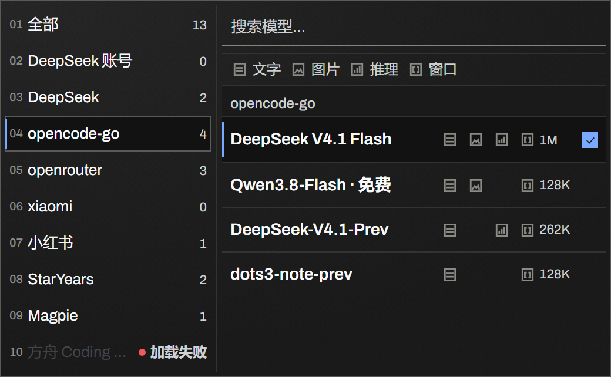 | 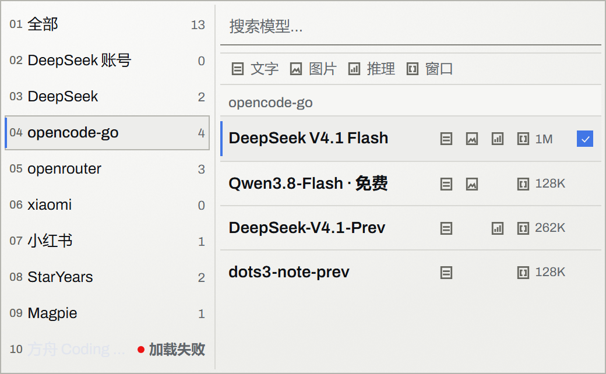 |
| 模型卡：范围切到「全部」——列表按 provider 分组；当前会话行仍带 2px 宿主蓝左条 | 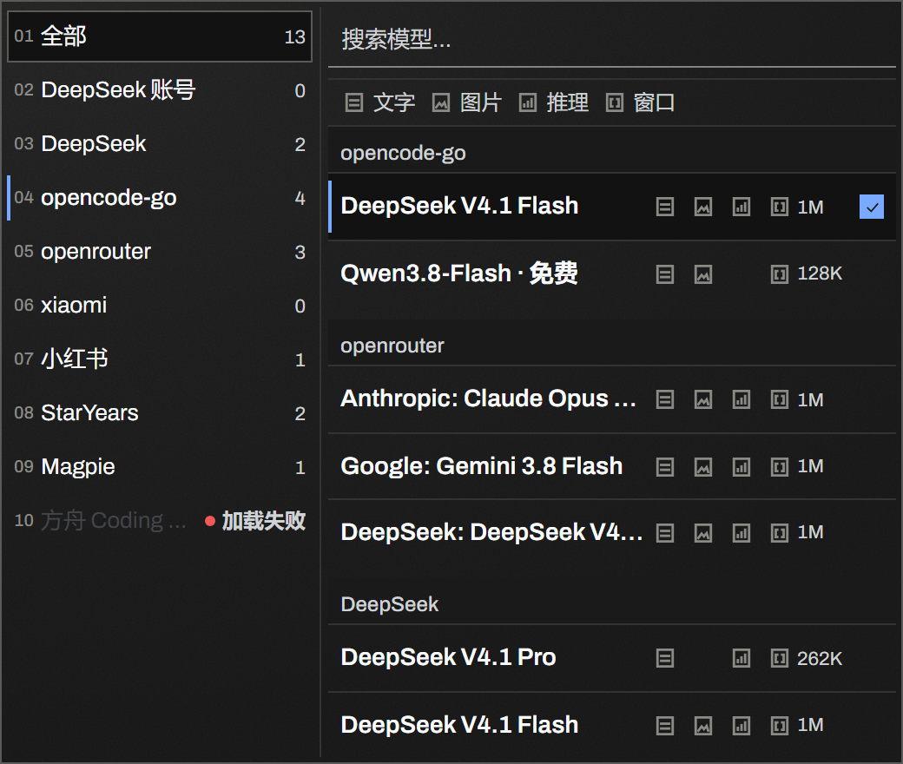 | 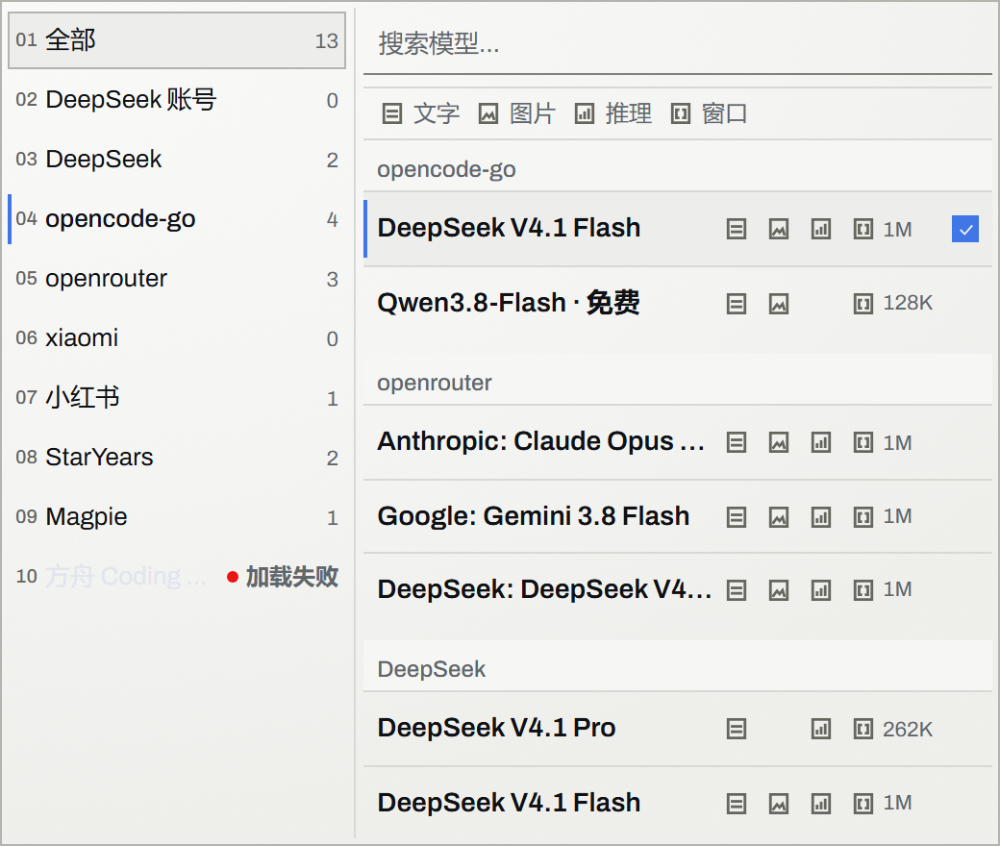 |
| 窄屏（≤536px）：提供商栏折成横向条，同一份 DOM | 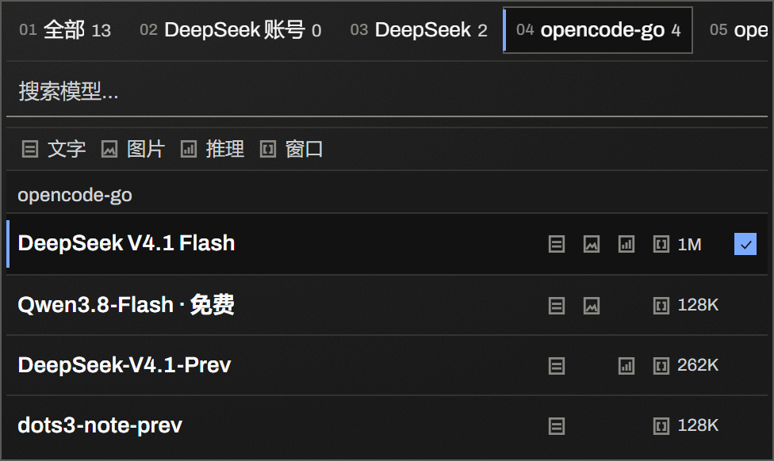 | 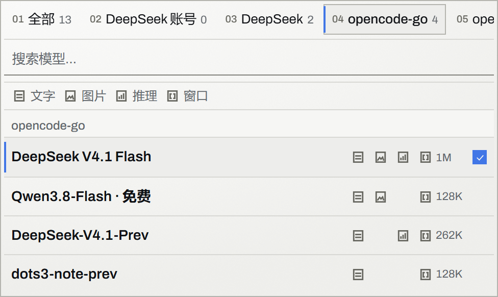 |
| 座位行：收起 / 模型卡打开 / 长模型名先省略号 | 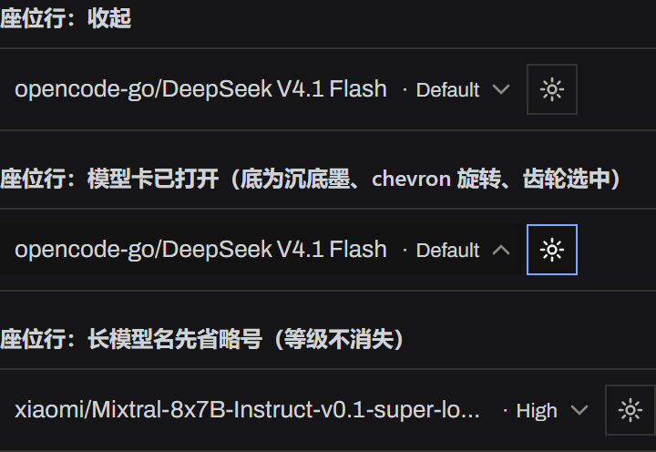 | 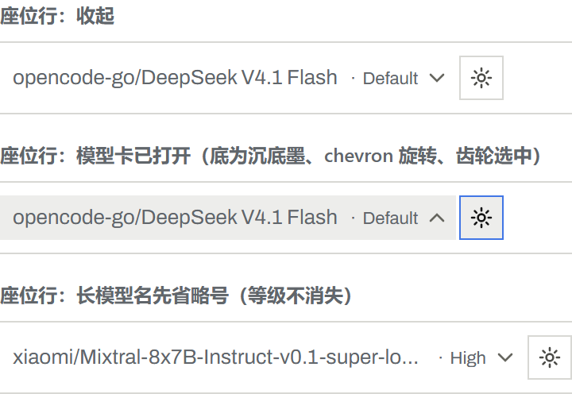 |
| 参数面板：模型名 + 恢复默认、三段中文标题、方形开关、选中档位 2px 蓝左条 + 蓝底勾 | 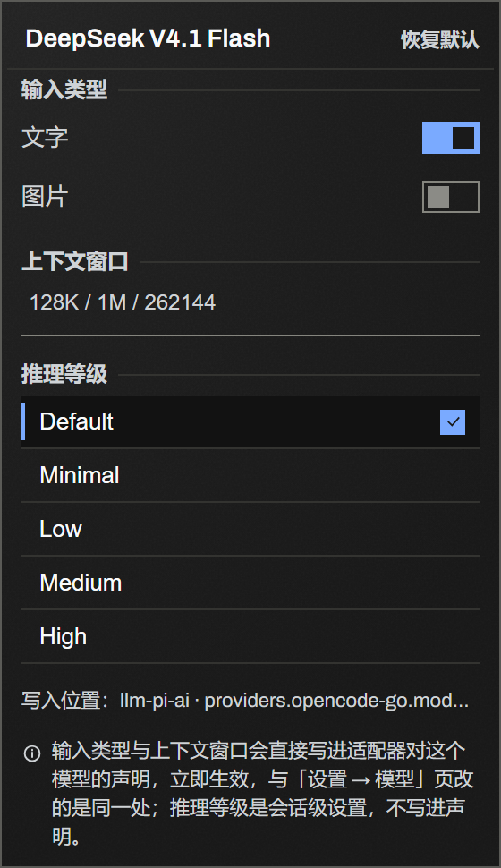 | 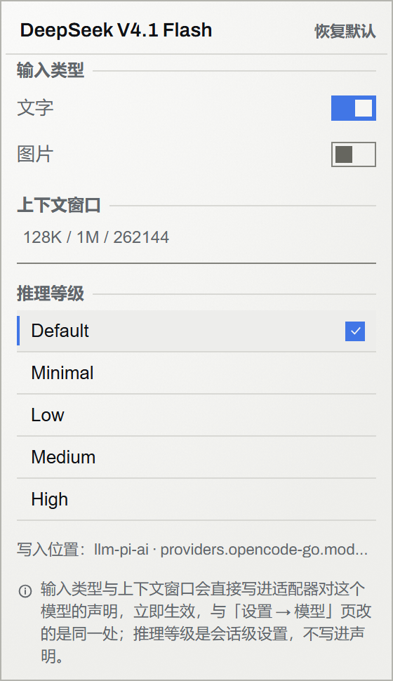 |
| 模型配置页 560px：页首陈述 + 48px 账本 + 设置井（重试编辑器）+ 目录区（发现清单） | 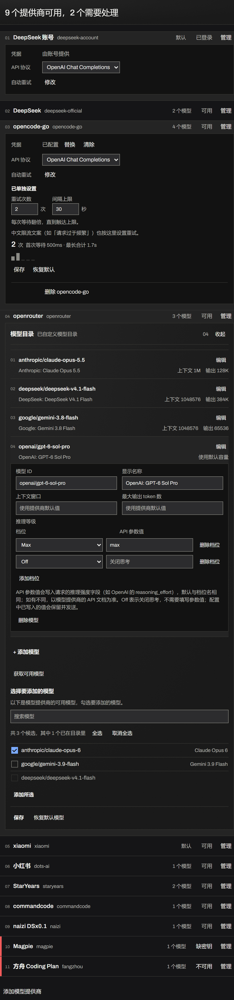 | 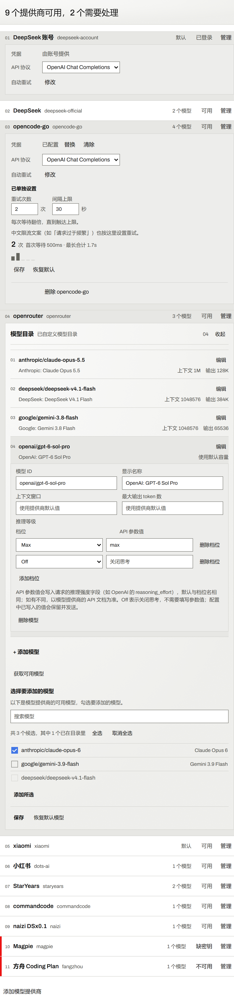 |
| 模型配置页 484px：井标签列 56px，行高仍 48px |  |  |
| 模型配置页 106px：宿主真机最窄内容列，扫描行四行堆叠、无横向溢出 |  |  |
| 空态：一句就绪陈述 + 添加入口 | 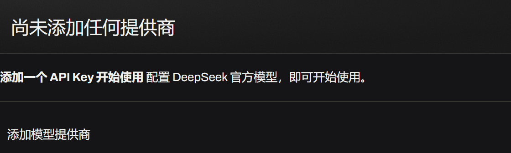 | 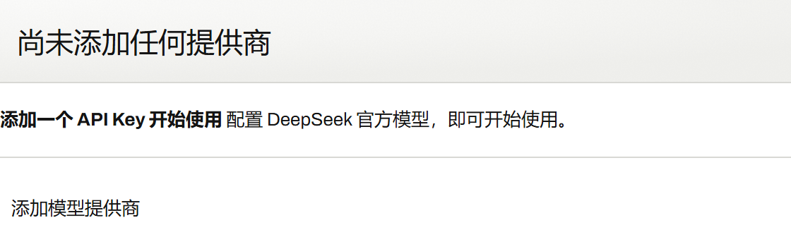 |
| 设置井展开：沉底墨 + 1px 线，标签列单行中文，末行「删除」前一条分隔线 | 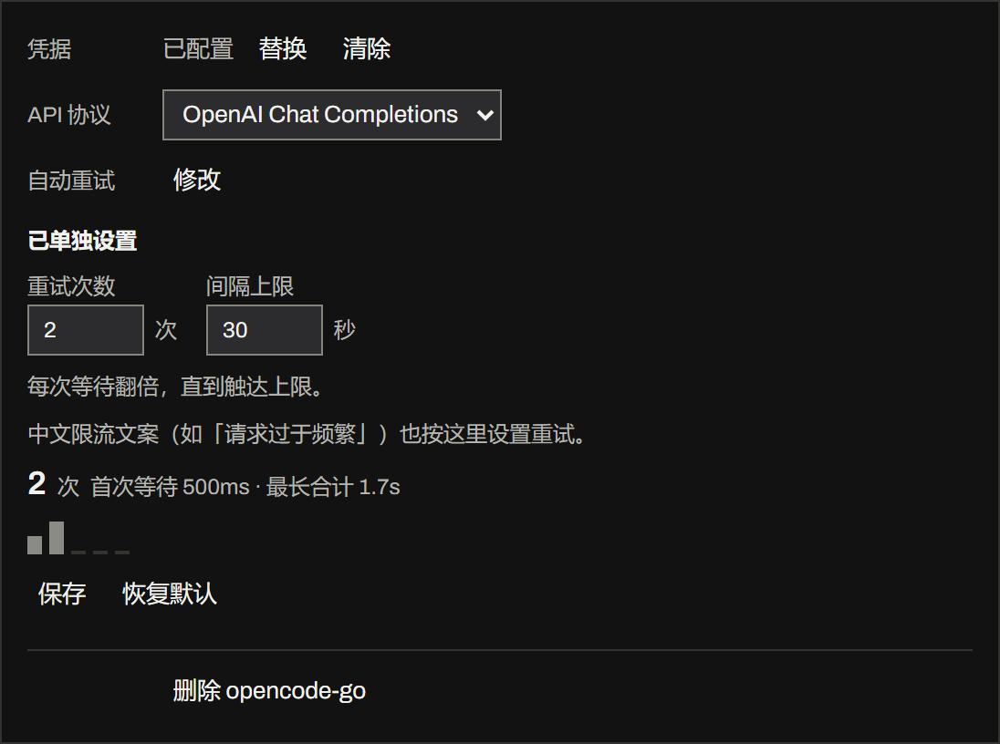 | 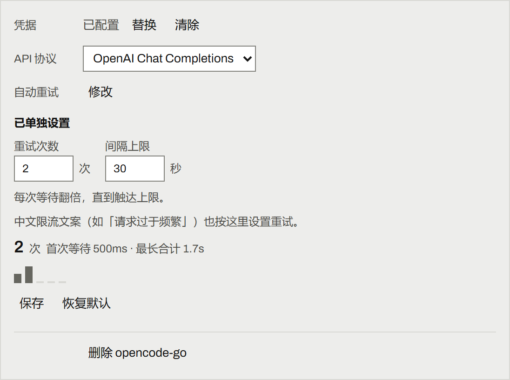 |
| 目录区展开：`模型目录` + 状态 + 普通计数、行内花名册、发现清单三态勾选框 | 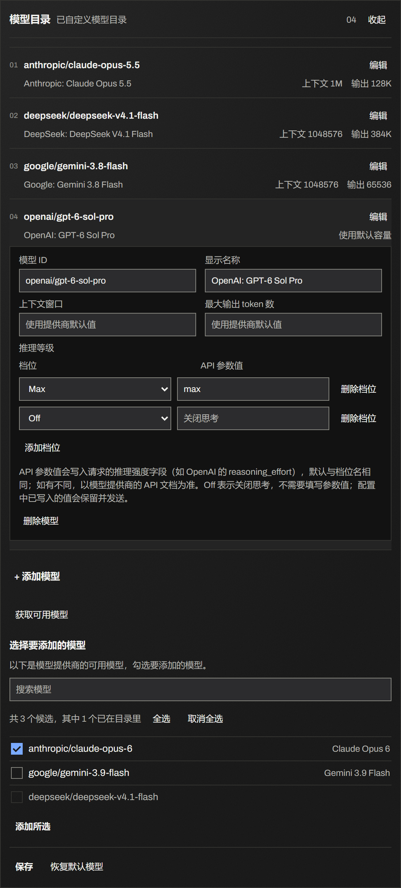 | 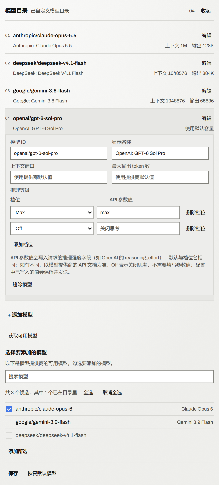 |
| 重试编辑器：两个数字框、摘要行、五槽灰阶退避刻度条（2 实 3 空，真实等待） | 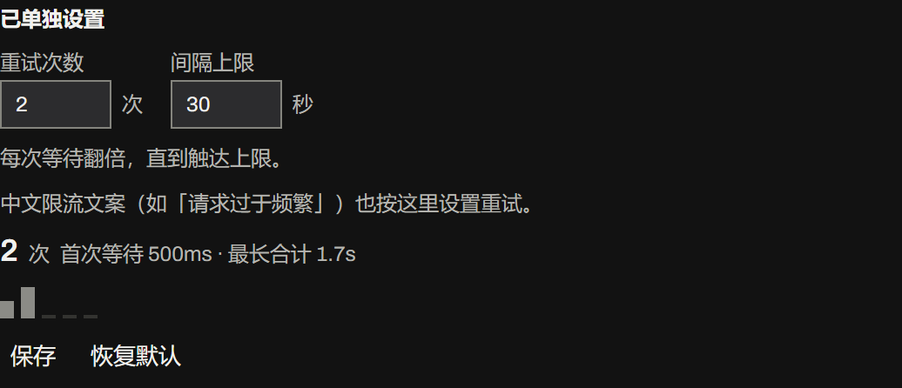 | 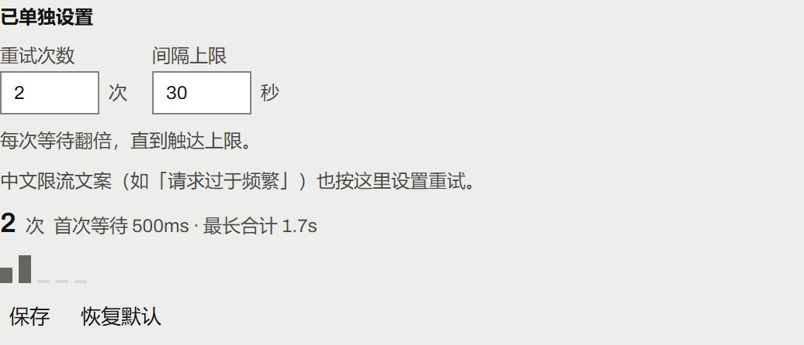 |

## 交互

| 动作 | 结果 |
|---|---|
| 座位上的触发器 | 写 `提供商/模型名`，右侧跟当前推理等级；窄屏按输入条的显示变量整段折成图标。悬停气泡给出完整身份；`aria-label` 同样带提供商与等级 |
| 点触发器 | 打开模型卡：**提供商栏选中当前会话的提供商**，模型列表只列它的模型、高亮落在当前模型上；提供商栏同时列出 `全部` 与其它 provider（带模型数，加载失败的排最后且不可选） |
| 点提供商栏某一行 | 模型列表只列该 provider 的模型；这一行 `aria-selected` 并带选中勾；**模型卡保持打开**，焦点落到搜索框 |
| 点提供商栏「全部」 | 显示全部 provider（这一次打开有效）。**如果你想找的模型在别的提供商，这是唯一出口** |
| 关闭再打开 | **回到当前会话的提供商**——不管上次停在哪个 provider，也不管上次是不是停在 `全部`（不写 localStorage） |
| 提供商栏的「当前会话」标记 | 这个会话真正在用的那个 provider：`aria-current` + 名字重一档（**不写字**——一行里再塞「当前会话」会把 provider 名挤成省略号，而那正是这一栏唯一的活） |
| 点模型行 | 切模型，模型卡关闭；点已选中的行 = 关闭 |
| 搜索 | 常驻、跨 provider 模糊匹配；**范围不影响搜索**——在收窄状态下搜到别处的模型会显示「其他提供商还有 N 个匹配」+「显示全部」 |
| 悬停某行 | `title` 给出整句事实（模型名、输入类型、能否推理、上下文窗口） |
| 点齿轮 | 打开参数面板：输入类型、上下文窗口、推理等级；profile 已声明的项带小圆点标记 |
| 参数面板改输入类型 / 上下文窗口 | **真写进 Host**：改适配器对模型的声明，立即生效；底部写明写入位置 |
| 参数面板填上下文窗口 | 接受 `128K` / `1M` / `262144`；留空 = 撤掉声明回到适配器默认 |
| 参数面板点「恢复默认」 | 撤掉本 profile patch 里的声明；无声明时按钮禁用 |
| 参数面板点推理等级 | **唯一改等级的地方**：走 `directory.select()`，改完行内徽章同步 |
| 无法寻址的路由 | 参数面板写明原因，并**陈述适配器目录公布的事实**（可编辑的控件仍然全部禁用）；适配器什么都没公布时，对应分区整块不渲染，不画成"不支持" |
| 键盘（模型列表） | `↑↓` 移高亮、`Home`/`End` 跳首尾行、`Enter` 选中；`←` 进提供商栏；`Tab` 按模型卡渲出的顺序走（提供商栏 → 搜索框及其按钮 → 各行），链首 `Shift+Tab` 关模型卡 |
| 键盘（提供商栏） | `↑↓` 在行间移焦点、`Home`/`End` 跳首尾、`Enter`/`空格` 采纳并回到搜索框、`→` 回搜索框；`Esc` 关模型卡 |
| 问答/审批/只读子代理顶掉输入条时 | 两个弹窗一起关掉（不还焦点）。判据是座位根有没有盒子，窄布局不误关。详见 DESIGN.md §5.18 |

## 行内徽章

每行右侧四个只读徽章，顺序固定。**四枚共用一套 16 单位网格**：11 单位方框 + 内部符号
（文本两条横线 / 图片山形 / 推理三根升序短柱 / 窗口两侧比例括号），统一 `stroke-width: 1.6`，
渲染 14px 即屏幕 **1.4px**，方头方角。**本轮不再有第二套 24×24 网格，也不再借用宿主的大脑图标**
——四枚是同一只手画的同一套方框符号，颜色只用墨（`--zmd-ink-mute` / `--zmd-ink-secondary`）。
宽度预算不变（见下）。

**四列固定**：每行始终画出四条轨道（`文字 / 图片 / 推理 / 窗口`），模型没有的事实**在它自己的列里留空**，
不画斜线、也不把邻居左移。所以四列逐行对齐、模型名那一列逐行等宽，眼睛可以上下比较同一件事。
搜索行下面那行**表头**（四个中文列名 + 上下各 1px 结构线）把四列各是什么说一次；四个词是功能
文案，不换英文码，右端也不再放计数。

| 徽章 | 含义 | 值 |
|---|---|---|
| 文字输入 | 该模型接受文字 | 不支持时该列留空 |
| 图片输入 | 该模型接受图片 | 同上 |
| 推理 | 该模型能不能推理（不是当前档位） | 同上 |
| 上下文窗口 | 该模型声明/默认的窗口 | 整数 + K/M（`1M` / `128K`，不出现 `1048576` 或小数） |

读取顺序就是适配器自己的顺序——**声明 → 适配器发布的目录 → 适配器的 provider 级默认**
（pi-ai 的 `entry.contextWindow ?? base?.contextWindow ?? defaultContextWindow`，
opencode-go 的 `modelInfo()` 同序），所以徽章和适配器实际用的值一致。

- **紧凑**：四条轨道固定为 14 + 8 + 14 + 8 + 14 + 8 + 47 = **113px**（窗口列 = 14px 字形 + 3px 间距 +
  30px 值）。两栏之后模型列表那一栏实测 331px，模型名列因此恒有 **175px**（单栏时代是 ~160px）。
  改造前常见三事实行约 107px、四事实行约 129px——
  **最坏情况反而变窄**，而且名字列的宽度不再逐行变化。详见 DESIGN §5.24（正文）、§5.25（两栏）与 §5.30（门）。
- **不猜**：模态与窗口先读 Host 设置快照，设置里查不到的再读适配器发布的目录；两者都查不到的**不显示**，不会画成"不支持"。
- **只读**：适配器目录来的事实没有任何可写目标，参数面板里对应分区禁用并写明来源。
- **可读**：徽章条带 `title`，整句同时是行的 `aria-label`，屏幕阅读器听到的是整句而非裸数字。
- **不可交互**：用宿主 `Tag` 原语 + `aria-hidden`，点徽章 = 点该行，无隐藏行为。

## 模型配置页（设置里的平行 tab）

宿主设置里新增的「模型配置」页（与官方「模型」页**并存**，ADR 0003）是这组表面的主场。
规范在 [`docs/ink-design-language.md`](docs/ink-design-language.md)，实现约定与类名清单在
[`docs/ui-language.md`](docs/ui-language.md)。2026-10-17 这一轮把它和输入条三表面一起重制成
**墨色**语言：页首一条墨晕带上的就绪陈述、48px 账本行、沉底墨设置井、行内目录区、井内重试
编辑器、单色 + 宿主蓝。**账本的结构决策沿用 2026-10-16 那一轮**：上一版每行「身份 + 六轨控件行」
在真机 560px 内容列里装不下自己的两个词（凭据格 108×60、行高 108px、整页 1248px）的问题没有回来。

**一句话**：一行一条路由，行上只陈述三件事实——**它是谁、它有多少模型、它现在能不能服务**——
改它的一切收进这一行的**设置井**。井是表单，不是控件的再一次横排。

| 决定的 | 说明 |
|---|---|
| **页首 `.dmc-head`**：`zmd-wash` + `zmd-grain` 的材质带上放一句就绪陈述（20px/500，live thing） | 无大序号、无字段码、无顶条；句子仍由 React key 重挂载做 160ms 落定，数字与列表由同一套读取算出 |
| **一行一条路由**（48px）：两位序号 / 身份 + route id / 模型格 / 答案词 / `管理` 文字动作 | 静止态没有表单控件；行间 1px 结构线；展开行 = `--zmd-hover` 底，门词 hover 蓝下划线 |
| **模型格是事实也是门**：`N 个模型`（无自有目录写 `默认`）点开该行的模型目录区（行内展开，不是抽屉） | 一个 12px 的「模型目录」词旁边悬着裸数字的旧形态已删除 |
| **设置井 `.dmc-well`**：`--zmd-panel-deep` + 1px 边的表单；标签列单行中文（凭据 / API 协议 / 自动重试）；末行「删除」前一条分隔线 | 破坏性动作与普通事实分开；井是表单，不是控件的再一次横排 |
| **答案词 + 竖条两个通道**：`data-state` = `ready` / `missing-key` / `unreachable`，诊断另用 `data-error` 可叠加、句子在井顶 | 旧的 `data-usable` 布尔把「未添加」和「缺密钥」压成一个红底，筛选后恒为 true |
| **`@container` 窄分支**（560 / 484 / ≤360，问 `.dmc-page` 的可用宽度）：484 把井标签列收到 56px，≤360 扫描行拆成四条线、隐藏序号、可点目标 40px | `@media (max-width: 900px)` 问的是视口，宿主面板宽 800px 时它在 1920 视口下永不触发 |
| **两套主题、一份令牌**：颜色只走 `--zmd-*`；蓝只做图形（2px 条 / 焦点环 / 选中勾底），墨色画字 | `check-contrast.mjs` 在亮/暗两个主题下逐条登记画字规则，墨晕两端各量一次 |

**有意不做的事**（写进报告，不是遗漏）：**0 张照片**——此题材是软件，它的图片就是它自己的界面；
**不做滚动入场编排**——这是别人的设置面板里的一个分区，在里面做首屏动画是错的；
**不按状态排序或分组**——账本保持目录顺序，需要处理的由答案词与竖条标出；
**不在装饰里造假数据**——退避刻度条只用重试策略真实算出的等待。

> 这一轮没有对运行中的 GUI 做 live 验收（原因、证据缺口与运行纪律见
> [`docs/agent-safety.md`](docs/agent-safety.md)）；README 里的图是**静态预览**，
> 用真实样式表与宿主真实 token 值渲染，能证明排版、几何与两套主题，不能证明宿主窗格里的
> 滚动、焦点链与 Esc 分层。

**模型目录区（§5.37，取代 §5.36 的右侧抽屉）** 是账本行自己的行内展开区：`zmd-wash` 面板 +
1px 边；头只写「模型目录」+ 自有状态 + 普通计数 + `收起`；一行一个模型（两位序号 / id /
`编辑` 门，第二行显示名 + 容量事实），四个字段、推理档位与 `删除模型` 收进该模型行的井；
`+ 添加模型` 是页尾文字动作（无装饰条）；发现清单用方形勾选框（未选 / 选中 / 已在目录三态，
选中是宿主蓝底 + on-accent 勾，后者禁用并整行降为次级墨色）。一个七模型的自定义目录因此从
「28 个常开输入框」变成「7 行 + 最多一个展开的井」。模型发现（获取 → 勾选 → 添加所选）的结构不变。
**它不是弹层**：目录区占满设置内容列（560 / 484 / 106），没有 fixed / scrim / `aria-modal` /
焦点陷阱；设置弹窗因此重新成为唯一一层 modal。草稿未保存时收起或切换提供商会先问一句
「有未保存的模型修改。继续编辑 / 放弃修改」。Esc 一次只关一层：模型井 → 目录区 → 宿主设置面板。

**重试策略（2026-10-17 从官方「模型」页搬进来）**

重试策略原本是注册进宿主「设置 → 模型」页的一张卡（座位 `settings.models.provider-card`，一个座位只能点名一个
适配器家族，所以只覆盖 pi-ai）。现在它是**「模型配置」页每个提供商行设置井里的一个字段**（`src/client/RetryEditor.tsx`）：
井里那行「自动重试」有一个**「修改」**动作，点它在井内展开编辑器，默认收起。

| 决定的 | 说明 |
|---|---|
| **覆盖范围由 schema 决定**，不是按 provider id 点名 | 只要该提供商的 profile 节点声明了 `retryPolicy` 就有入口——**官方 `llm-deepseek` 也算**（它的 `retryPolicy` 在命名空间根、`settingsPath` 为 `[]`），pi-ai 家族是 `['providers', <route>]`。**读不出 schema / 路径走不通就不显示入口**（失败关闭，与协议选项读不出返回空同一纪律） |
| **编辑器里有什么** | 来源词（`已单独设置` / `使用默认值`）→ 两个数字字段（重试次数 / 间隔上限秒）→ 一句 `每次等待翻倍，直到触达上限。` → 一行摘要（默认策略下算出来是 `5 次 · 首次等待 500ms · 最长合计 17.1s`）→ **5 槽退避刻度条** → `保存` / `恢复默认` 与状态行（`已保存` / 失败原话） |
| **退避刻度条（不是柱状图）** | 等待节奏的插图仍不复存在；现行设计只画 5 个 8px 方块，每格高度按 `retryWaitCurve` 的**真实等待**取 4 档、格数 = 策略实际会花的等待数，空槽是 `--zmd-line` 里的基线而不是数据；配色是灰阶（实心 `--zmd-ink-mute`、空槽 `--zmd-line`），整条 `aria-hidden`（摘要句已经用文字说了同一件事），`prefers-reduced-motion` 下不动。`最长合计` 是**带 jitter 的上界**（`waitRange(...).high`）——旧卡在同一标签下印的是"名义总和"，那是执行器从来不会真的花掉的数，标签在撒谎 |
| **写回走本页自己的 store** | `store.write(ns, ops, namespace.revision)`：保存写 `[...settingsPath, 'retryPolicy']`（两个数字都没变则不写，免得凭空造出 revision 冲突），恢复默认 `unset` 该路径。`settings/conflict` 重读重试、Host 拒绝原话照显，与官方页那条写入纪律同一份实现 |
| **样式并入 `dmc-` 域** | `drc-` 前缀退役；复用既有的提示行 `.dmc-notice` 与去铬动作 `.dmc-key-action`，不新增重复规则。旧卡的 `.drc-btn-primary`（accent 实心填充 + 白字）是已记录的 **4.2349:1（浅）/ 2.3278:1（深）** AA 失败——搬进 `dmc-` 后这条缺陷随设计消失，并由对比度门永久守住 |
| **中文限流文案也走这里**（§5.34） | 有一类失败到不了重试链：网关在流里回 `请求过于频繁，请稍后重试`（**不带 HTTP 状态**），宿主分类器只认 `429`/`rate limit` 与英文 quota 措辞，于是它落进不可重试的兜底码 `PI_AI_ERROR`，**重试编辑器上的设置一次都不会被咨询**（实测 18 次失败、0 次重试、2~6ms 即终止）。Host 侧因此在 `agent/request-error` 瀑布**最外层**把这类失败**按 `RATE_LIMIT` 重新提交**给内建执行器——等待节奏、重试次数、界面上的「等待重试模型请求」行**仍由上面这两个数字决定**，本插件不自己等、不自己计数。编辑器里那行 `中文限流文案（如「请求过于频繁」）也按这里设置重试。` 说的就是它。**去掉该策略里的 `RATE_LIMIT` 即整体关闭**；重试耗尽后终态仍如实记原始码与原话 |

## 安装

由 DSH 自己写 profile（不要手改 profile 的 `package.json` / `cordis.patch.yml`）。
在插件的「添加插件」输入框里粘贴包名即可：

```
dsh-rabbit-model-picker
```

也可以粘 GitHub 地址：

```
github:a285292107s/dsh-rabbit-model-picker
```

或写成 `https://github.com/a285292107s/dsh-rabbit-model-picker`。

这条命令：拉取/安装 → 加进 `dsh.profile.bundles` → 应用包内 `cordis.patch.yml` 的 insert 行。
返回 `application: applied` 即生效；页面刷新后新座位接管。

> ⚠ **git 安装不会构建。** `lib/` 是**提交进仓库**的产物，不是安装时生成的——pnpm 拉 git
> tarball 只搬运仓库里已有的文件，没有构建步骤。所以改了 `src/` 必须重新 `npm run build`
> 并连同 `lib/` 一起提交，否则用户装到的是旧行为（或 `lib/` 缺失时报
> `failed to import`）。`npm test` 里的 `test:fresh` 门会拦住这种漂移。
> （npm 发布走 `files` 白名单，同样只有在 `prepublishOnly` 构建后才会带上 `lib/`。）

**本机开发**用 `link:` 指向工作目录（改完 `npm run build` 刷新页面即生效）：

```
plugin_manager { action: "install_bundle", target: "C:/Users/28529/Desktop/dsh-rabbit-model-picker" }
```

**回退**：`plugin_manager { action: "remove_bundle", target: "dsh-rabbit-model-picker" }`，或删掉 insert 行。

## 开发

```bash
npm install          # esbuild + typescript + @types/react
npm run build        # esbuild → lib/index.js（宿主）+ lib/client.js（客户端）
npm run font:build   # 重新子集化内嵌拉丁字体资产（需 Python/网络；产物 src/client/fontAsset.ts 已提交）
npm run typecheck    # tsc --noEmit（含 noUnusedLocals/Parameters）
npm run test:fresh   # 已提交的 lib/ 是否是已提交的 src/ 的忠实产物（产物漂移门）
npm run selfcheck    # 静态禁令 + 令牌层 + 材质原语 + 字体资产 + 座位契约 + 文案键 + 宽度预算
npm run contrast     # 文字对比度门：解析 --zmd-* 两主题，逐条画字规则 + 墨晕两端 + 抑制蓝作文字
npm run test:params  # 参数寻址/容量 + 行内事实推导 + 面板文案决策的单元门
npm run test:retry   # 重试策略解析、等待曲线（退避刻度条的数据源）与写入文档的单元门
npm run test:recovery          # 限流文案恢复的判定门：五个条件、文案表、副本语义（§5.34）
npm run test:model-config      # 「模型配置」页的纯逻辑层与 store 单元门
npm run test:model-config-copy # 该页文案门：key 集、zh/en 同序、插值对称、概念覆盖
npm run test:mutations # 改坏验证：旧门（§5.31 / §5.34）的改坏必须逐条变红
npm run test:mutations:ink # 墨色新增门的改坏证明
npm test             # 上述全链（typecheck → build → test:fresh → selfcheck → contrast → 单元门 → 两套改坏验证）
```

> 这些门在 GitHub Actions 上随每次 push 跑一遍（`.github/workflows/test.yml`）：
> `lib/` 漂移会在 push 阶段被拦下，而不是等某次 git 安装装到旧行为。
> `test:mutations` 是"门自己的门"：它把每条判断逐个改坏，确认有一条门真的会红；
> 改坏要是打不上去了，它**算失败并点名**，而不是静默跳过（§5.31）。
> §5.34 修掉了它的判据：原先用 `output.includes('FAIL')`，而 selfcheck 有一条绿灯行里就写着
> `no FAIL on the four round surfaces`——于是每条改坏都被报成"selfcheck 抓住"，包括它自己 exit 0 的那些。
> 现在判据是 **exit≠0 或行首 `FAIL`**，报告的归属因此是真实的。

> `lib/` 是提交进仓库的（见「安装」）。**动过 `src/` 就要把重建后的 `lib/` 一起提交**，
> `npm run test:fresh` 会在两者不一致时失败。它比较的是 **HEAD 里的那一对**
> （`git archive HEAD src tsconfig.json` 重新构建，对上 `git show HEAD:lib/…`），
> 也就是 git 安装真正收到的东西——所以它不关心门跑在 `build` 之前还是之后，
> 也不会因为工作区改了一半就报警。

`npm run contrast` 优先读本机装的 DSH 主题表；没装时回落到仓库里提交的
`scripts/theme-tokens.json`（`npm run theme:fixture` 可重新生成），因此在 CI 上
也是真的在量，而不是打一行 `skip` 就绿。它量的是两种下层底色里较差的那种，
面板浮在哪一层都不影响结论。

浏览器端验收（页面需已用 `dsh web` 打印的 URL 完成认证）：

```bash
playwright-cli -s=verify open 'http://127.0.0.1:3080/?token=<token>'
playwright-cli -s=verify --raw run-code --filename=./scripts/_accept-provider-rail.cjs   # §5.25/§5.26 两栏 + 触发器身份 + 范围
playwright-cli -s=verify --raw run-code --filename=./scripts/_accept-anchor-loss.cjs     # §5.18 锚点消失
```

> ⚠ 改了 `src/` 后 **`location.reload()` 不够**：Loader 用 `rev` 键给 client 模块，浏览器可能返回旧 body。
> 先 `Network.setCacheDisabled` 再 reload，并在记录结论前断言 bundle 里确实有改动。
> `_accept-provider-rail.cjs` 的第 0 步就是这条断言（还顺带断言旧 popover 的符号已经不在了）。
>
> ⚠ 本目录自 2026-10-02 起有 git 历史（`master` → `origin`），但早期被误删的几个验收脚本
> （`_badges-probe.cjs` / `_icons-probe.cjs` / `_verify-fixes.cjs` / `_verify-settings.cjs`）不在任何提交里，
> DESIGN.md 里对它们的引用仍是待重写的清单。

改了 `lib/client.js` 后刷新页面即可：宿主按产物哈希拼接 client 模块，重建后刷新会取到新文件。
（`lib/` 已提交进仓库——见「安装」，重建后记得连同 `src/` 一起提交。）

## 结构

```
src/index.ts               宿主半边：把限流文案恢复挂到 `agent/request-error` 瀑布的最外层（§5.34）
src/host/rateLimitRecovery.ts 该判定的纯逻辑：五个条件 + 文案表 + 副本语义（不等待、不计数、不写事件）
src/client/index.ts        入口：inject 声明 + slots.inject → register(priority:-10)
src/client/designSystem.ts  墨色设计系统：内嵌 ZMD Archivo 的 @font-face + `--zmd-*` 令牌层（亮/暗两主题）
                            + 材质原语 `.zmd-wash` / `.zmd-grain` / `.zmd-rule` / `.zmd-num`
src/client/fontAsset.ts     生成产物：子集化 woff2 的 base64 data-URI + 字体来源/许可证元数据（勿手改）
src/client/Picker.tsx      触发器（`提供商/模型名 · 推理等级`）+ 齿轮 + 两栏模型卡
src/client/ProviderRail.tsx 提供商栏：范围列表（全部 + 各 provider + 失败行），listbox + roving focus
src/client/BadgeIcons.tsx  四个徽章图标（只有"具备这个事实"一种形态；缺失的事实不画）
src/client/facts.ts        徽章词汇表（渲染层与推导层共用）
src/client/badges.ts       行内事实推导（纯函数）
src/client/capabilities.ts 适配器发布的能力目录（只读事实 + 读取策略）
src/client/adapterCatalog.ts 适配器自有目录的读取器与路由表（"没挂载"≠"什么都没发布"）
src/client/snapshotEq.ts    快照内容比较：什么都没变就不叫醒订阅者（DESIGN §5.28）
src/client/focusChain.ts    模型卡的 Tab 链：从渲出的 DOM 读，只在某状态下出现的控件也够得到（§5.29）
src/client/format.ts       徽章专用窗口写法（整数 + K/M）
src/client/effort.ts       推理等级档位的命名与列表
src/client/SettingsMenu.tsx 模型参数面板
src/client/modelConfigModel.ts 「模型配置」页的纯逻辑层（providerUsable / joinProviderDirectory / pathOps…）
src/client/modelConfigStore.ts 该页的事实 store（订阅、代际、写入）
src/client/modelConfigCopy.ts 该页的文案数据（KEYS / zh / en 三块同键同序）
src/client/modelConfigStyles.ts 该页的样式表（`dmc-` 前缀；`@container` 窄分支；重试编辑器那批新类也在这里，§5.33）
src/client/ModelConfigPage.tsx 该页主体：就绪陈述 + 账本行 + 设置井（状态由 data-state/data-error 承载，§5.35）
src/client/ModelCatalog.tsx 模型目录区：行内展开的花名册（编辑进井）+ 三步模型发现（§5.37）
src/client/catalogStyles.ts 目录区的样式表（同一 `dmc-` 前缀，独立查死类；不再有 fixed/scrim）
src/client/panelCopy.ts     面板文案（纯数据）
src/client/RetryEditor.tsx  模型配置页设置井里展开的重试编辑器（`dmc-` 域，DESIGN §5.33）
src/client/retryPolicy.ts   重试策略的解析与等待曲线（纯函数，编辑器与门共用同一公式）
src/client/anchorLoss.ts    座位离开版面判据（纯逻辑）
src/client/params.ts        参数寻址与读写（含 revision 冲突重试）
src/client/retiredScope.ts  旧范围记录的键前缀 + 一次性清理（数据契约，不含行为）
src/client/dictionary.ts    zh/en 文案 + 本地兜底
src/client/styles.ts        输入条三表面样式表（座位/模型卡/参数面板；`dmp-` 域，颜色只走 `--zmd-*`）
src/client/contract.ts      外部结构类型 + `rowKey`（行身份 `${provider}/${model}`，
                            原住在已删除的 recent.ts，现在归这里）
src/client/primitives.d.ts  唯一运行时基线依赖类型边界
scripts/build-client.mjs    esbuild 构建 + 接线自检
scripts/build-font-asset.mjs 内嵌字体的获取/子集化/base64 生成（`npm run font:build`）
scripts/selfcheck-static.mjs 静态禁令 + 令牌层 + 材质原语 + 字体资产 + 契约 + 宽度预算等
scripts/check-contrast.mjs  文字对比度门（含墨晕两端与强调蓝禁作文字）
scripts/test-params.mjs     参数寻址/事实推导/文案决策 + 旧范围键清理的单元门
scripts/test-retry-policy.mjs 重试策略解析、等待曲线与写入文档的单元门
scripts/test-rate-limit-recovery.mjs 限流文案恢复的判定门（自包含，不依赖宿主安装；§5.34）
scripts/mutate-anchor-loss.mjs §5.18 改坏验证
scripts/mutate-ink-gates.mjs 墨色新增门的改坏证明
scripts/_accept-provider-rail.cjs §5.25/§5.26 浏览器验收（两栏、触发器身份、范围每次重来、越界搜索、窄屏折叠、键盘）
scripts/_accept-anchor-loss.cjs §5.18 浏览器验收
scripts/_accept-capabilities.cjs §5.19 浏览器验收（只读：内置目录的模型到底读到了什么）
scripts/_verify-settings-layout.cjs 参数面板仍是"头在上、正文在下"的列（材质类共用的守卫，§5.25）
scripts/_audit-shots.cjs      品质自查截图（两张主题 × 四类表面；当前宿主跟随系统深色，浅色走「设置 → 外观」）
scripts/_fixture-css.mjs      静态预览的唯一 CSS 入口：宿主真实 token + designSystem.ts + 三张真实样式表
scripts/_preview-ink.mjs      墨色静态预览 fixture 的 DOM 镜像（卡宽/卡窄/座位+面板/配置页四档）
scripts/_page-preview.mjs     写配置页 fixture（转调 `_preview-ink.mjs`；旧入口保留）
scripts/_render-row.cjs       写模型卡 fixture（同上）
scripts/_render-trigger.cjs   写座位+参数面板 fixture（同上）
scripts/_shoot-row.cjs        墨色卡截图 `ink-card-*.png` + 卡宽/窗格/名字/徽章条/行高/wash+grain 实测
scripts/_shoot-trigger.cjs    墨色座位/面板截图 `ink-seat-*.png`/`ink-panel-*.png` + 触发器/面板实测
scripts/_shot-page.cjs        墨色配置页截图 `ink-settings-*.png`/`ink-well/catalog/retry` + 行高/右沿/106 溢出/刻度/勾选框实测
scripts/_dump-design-css.mjs  把 `designSystem.ts` 的整张表落到 `shots/_design-system.css`（被忽略的中间产物）
scripts/_shot-readme.cjs      历史：README 的旧 560px 单栏截图（35/36、40/41），不再重生成
scripts/_taste-readme-shots.cjs 历史：重拍 README 旧表面的脚本（深/浅两套），不再重生成
docs/ink-design-language.md   墨色设计语言规范（本轮单一事实源：令牌/字体/几何/逐表面/动效/门映射）
docs/ui-language.md           墨色实现约定：类名清单、状态钩子、材质层叠、响应式、动效、门映射
docs/adr/0005-ink-language.md 这一轮方向取舍的 ADR（为什么从 HUD 改成墨色）
docs/fonts/Archivo-OFL.txt   内嵌字体的 SIL OFL 1.1 正本（随包提交）
docs/agent-safety.md          运行纪律与 2026-10-17 事故记录：不要结束别人的进程、不要在同一 DSH_HOME 上起第二个 dsh web
scripts/_dump-tokens.cjs      按主题打印宿主令牌原值（设计改动前查 --dsw-* 用，只读）
scripts/_anchor-loss-probe.cjs  复现锚点消失（开发用，只读）
scripts/_squeeze-probe.cjs     窄输入条压测（开发用，只读）
```

## 依赖的外部契约（升级 DSH 后先跑自检）

| 契约 | 为什么关键 |
|---|---|
| `conversation.input.model` 是 `single`、最低 `priority` 渲染 | 靠 `priority: -10` 遮蔽默认 0；同优先级重复注册会抛错 |
| `ctx.slots.inject(name, cb)` | 插槽由 ui-conversation 声明，注册时机与声明顺序无关 |
| 座位面 `{ available, directory, load, select }` | 直接读注入面，无中间层 |
| `remote` + `remote.session` 必须自己 inject | `directoryFor()` 读 `this.ctx.remote.session`；不声明则座位让位（静默回退） |
| `remote.settings` / `remote.llm` 用 `ctx.get` 取，不进 inject | 精简/旧部署可能没有；写进必需注入会让整个座位让位。取不到时面板降级为只读 |
| 这两个面**每次读时**才 `ctx.get`（`settingsFaceOf` 返回取值函数） | remote 命名空间是异步挂载的：激活时抓到 `null` 会变成"这个部署没有设置服务"这个**假的事实**，且整页只读。真不挂的部署仍然照实报只读 |
| `llm/listConfigurableProviders` → `{ provider, settingsNs, settingsPath }` | 路由 → 配置位置的唯一权威映射 |
| `settings/describe` → `{ value, user, revision }` | `value` 是真值，`user`（profile patch）判断是否自己声明过 |
| `settings/mutate` 只接受 volatile 路径，冲突码 `settings/conflict` | 写入唯一入口；冲突要重读重试，拒绝显示原话 |
| 适配器把模型参数声明为 volatile | 非 volatile 路径会被拒绝；本插件只改这两类字段 |
| `llm/discoverModels(settingsNs, { provider })` 是 `@Remote`，返回 `contextWindow / maxTokens / inputModalities` | 内置目录路由的只读事实来源；`declared !== true` 才调用——适配器自称"只从配置知道"时这次调用会去打 endpoint |
| 适配器自有的 remote 命名空间（如 `opencodeGoModels/read`） | 有的适配器（`dsh-opencode-go`）不注册 configurable provider，这条是唯一读得到它的路 |
| remote 命名空间一律是 `remote.<namespace>` 服务，且**异步挂载** | 读取时按需 `ctx.get`，才不会把插件激活顺序变成事实来源；**命名空间还没挂载时"读不到"**（不是"适配器什么都没发布"），这样开卡早于挂载也不会把唯一一次询问消耗掉 |
| 宿主 `--dsh-composer-model-text-display` / `--…-icon-display` | 窄屏折成图标；不消费就挤爆工具行 |
| 宿主 label 令牌对比度（caption 2.08:1 / dimmed 1.23:1） | 不能用来写面板说明文字；`npm run contrast` 即为此存在 |
| `MenuSurface` 底色是半透明子元素 | 对比度取决于合成到哪一层；门按两种底层里较差的那层判。墨色方向把该层改成透明、由 `.zmd-wash` 画材质，文字再被抬到 `z-index: 1` |
| 宿主在 `<body>` 上切换 `data-ds-dark-theme` 布尔属性 | 双主题只靠这条属性：`designSystem.ts` 用 `body[data-ds-dark-theme]` 覆盖 `--zmd-*` 令牌（含 wash 两端），没有 JS 侦测 |
| 宿主字体变量 `--dsh-font-family-text` / `-default` | 内嵌 ZMD Archivo 只覆盖拉丁与数字，中文仍走宿主字体栈 |
| 宿主 `Tag` 原语（`tone: neutral`，渲染成 `span`） | 行内徽章用它，"只读"是结构性的 |
| `deepseek-account` / `deepseek-official` 是 provider id | 提供商排序（账号/官方置顶）与 chip 本地化写死这两个 id；宿主改名只会静默退化，selfcheck §13 把它们钉住 |
| composer 卡片元素带 `[data-composer-card]` | 失败 toast 以它为锚；找不到时 toast 仍显示但没有锚定位置 |
| 基线模块表隐式外部化 | 不要写进 `dsh.client.external` |

## 已知边界

- **材质是局部的、不承载信息**：墨晕（`.zmd-wash`）与纸纹（`.zmd-grain::after`）只出现在模型卡、
  参数面板、配置页页首带与目录区面板；grain 是 data-URI SVG 噪点覆盖层（无 `opacity` 属性，
  靠 SVG 自带约 5% alpha），文字被抬到它上面。`prefers-reduced-motion` 不关它（它不是动效）。
  静态预览脚本会实测这两条计算样式存在、HUD 构件数量为 0。
- **方向被否过一次**：2026-10-17 的第一版是「终末地 HUD」，因「不是游戏 HUD、软黄色与 DSH 默认色
  差异过大」被用户否决并整体移除（字段码、信号黄、大序号、切角、扫光全删）；`docs/ui-language.md`
  附录保留更早的「路由账本」历史文，仅作证据。

- **参数面板三项都生效，但各走各的门**：
  - **输入类型 / 上下文窗口** → 写进适配器声明，通过 `settings/mutate` 落盘到 `cordis.patch.yml`（与「设置 → 模型」页同处）。前提是路由在配置里有声明；模型来自内置目录时面板改为**陈述适配器目录公布的事实**（只读），并说明没有可编辑的声明。
  - **推理等级** → 走会话选择 `directory.select()`，参数面板是唯一入口。
  - 写入**乐观不了**：面板显示来自 Host `describe`，拒绝时显示原话并保持原值；revision 冲突自动重读重试。
- **行内徽章只陈述读得到的事**：声明 → 适配器发布的目录 → provider 级默认；三者都没有的内容**不渲染**（不是画成"不支持"）。推理一列始终在四轨表里占位（§5.24）：模型没有 `reasoning` 元数据时那一格**留空**，斜线划掉的形态已撤除；「不支持推理」仍完整进徽章整句，而整句同时是行的 `aria-label`。
- **能力目录每个已答复的 provider 每页读一次，不轮询**：一个 provider 一次 Remote 调用（`ensure` 合并重复请求、结果缓存在插件实例里），页面刷新才会重读。行内徽章在**模型卡打开时**才触发读取，从不开模型卡的会话不花这次调用。没读到答案的询问（LLM remote 还没挂载、目录读失败、传输失败）不算答复——provider 被释放，下次打开模型卡/参数面板会重试；适配器自己拒绝的 discovery 仍算答复，不重试。**判据是"这次询问有没有得到答复"，而不是"哪个 provider"**：适配器自有的目录 Remote 还没挂载时同样算没答复（不是"什么都没发布"），所以开模型卡早于适配器挂载也读得到事实；反过来，已经答复过的 provider 不会再被读第二次——即使中途有新 reader 登记，重跑也只会发生在那次**尚未答复**的询问上（DESIGN §5.27）。
- **`declared === true` 的路由不读**：那是适配器自己承认"只从配置知道这个路由"，它的 discovery 会去打 endpoint（联网 + 用凭据），不是选模型该悄悄付的代价。这类路由保持"什么都没公布"。
- **适配器即时重解析**是读代码确认的（`llm-pi-ai` / `llm-deepseek` 把参数声明为 `.volatile()` 并监听 `loader/volatile-update`），不是 UI 观测——目录至今只发布 `{ provider, model, reasoning }`。
- **粘性分组头**：宿主观察器在页签隐藏时不回调，滚到头下会重叠。本插件改为始终填 `--dsw-alias-menu-group-header-fill`，代价是分组头一直有 22px 底色带。详见 DESIGN.md §5.8。
- 目录加载失败、选择被拒、subagent 会话、`locked` 禁用态、pending 菊花已实现但**未在本机实测**。
- 参数面板**只读分支**（路由不可寻址 / profile 不接受表单编辑 / 部署没挂设置服务）已实现，只做了单元层覆盖，**未在真实 Host 上构造**。其中"部署没挂设置服务"这一支的**判据已收紧**（DESIGN §5.27）：设置面是每次读时取的，所以"还没挂上"不会再被误报成"这个部署没有"。真不挂的部署仍然照实说只读。
- 设置快照在挂载时读一次、**模型卡和参数面板每次打开时重读**、写入后用 Host 返回值更新；**没有订阅 host 的设置推送**——面板开着的时候去「设置 → 模型」页改，要等下次打开模型卡/参数面板或本插件写入才看得到。
- **两栏的宽度是算出来的，不是调出来的**（DESIGN §5.25）：模型卡 `min(520px, 100vw - 32px)`；模型列表那一栏必须留够四轨事实表要的 320px，提供商栏的盒子实际占 181px（176 的 flex basis + 内边距 + 1px 分隔线）。实测：模型列表 331px、模型名列每行 **175px**（单栏时是 ~160px）、提供商栏最长名 132px 无省略号、13 行不滚动。**视口 ≤536px 时两栏折成一栏**（提供商栏变横向条），同一份 DOM、同一套 role，只有 flex 方向变。这条预算是**门算出来的**（§5.30）：静态门从模型卡一路走到名字列，并把结果校准到上面这两个实测数字，所以"把提供商栏改宽"或"把模型卡改窄"会当场变红，而不是安静地把名字挤没。
- **触发器说模型的身份**（DESIGN §5.26）：`提供商/模型名`，右侧跟推理等级。提供商前缀在这里是因为
  两个 provider 真的有同名模型；旧版那个只读的 provider chip 已删除（同一件事不说两遍，也把宽度还给模型名）。
  没有选中模型时只剩「请选择模型」/「正在加载模型…」，`aria-label` 同样带提供商与等级。
- **范围不持久化，每次打开都从当前会话的 provider 开始**（DESIGN §5.26）：`providerFilter` 是组件内的
  一次性视图状态，`providerFilter === null` 表示提供商栏第一行 `全部`。收窄**只影响列表、不影响搜索**，
  也不写 Host、不影响 `/model` 与触发器。旧版写在 `localStorage['dsh-model-picker.provider.*']` 的记录
  **已不再读写**；那些键还留在用户浏览器里，由 `retiredScope.ts` 在插件激活时一次性清掉（键名保持
  改名前的拼写，selfcheck §15 钉住）。
- **`.dmp-menu` 是模型卡与参数面板共用的材质类**：模型卡额外带 `.dmp-card` 才是两栏（`flex-direction: row` + 520px）。参数面板同时带 `.dmp-menu` 与 `.dmp-settings`，两栏样式若写在 `.dmp-menu` 上会把它的头部和正文并排——`scripts/_verify-settings-layout.cjs` 就是这道守卫（本机实测：280×460，头在上正文在下）。
- 触发器写 `提供商/模型名` 与推理等级；`aria-label` 另带「推理等级 X」。
- **座位离开版面时两个弹窗关掉**（不还焦点）。判据是座位根有没有盒子，窄布局不误关。详见 DESIGN.md §5.18 / §8.7。
- **重试编辑器的入口随 schema，读不出来就不显示**（DESIGN §5.33）：判据是设置 schema（`retryCapable` 从 `schema.uid` 走查到该提供商的 profile 节点有没有 `retryPolicy`），不是 provider id 或适配器名单——所以官方 `llm-deepseek`（`retryPolicy` 在命名空间根、`settingsPath` 为 `[]`）与 pi-ai 家族一视同仁；schema 读不出来就**整个入口不渲染**（失败关闭），代价是「明明声明了却看不到」优于「显示一个写不进去的入口」。**只读部署里入口仍可展开查看现值**，但两个输入与两个按钮禁用，并写明 `此部署已只读，无法修改重试设置。`。`mode === 'always'` 的提供商照常显示次数，额外说明「此提供商设为无限重试，次数不影响它。」（不隐藏字段：那是当前文档里的值，只是此刻不生效）。
